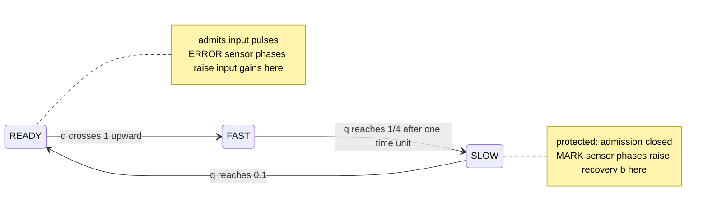

# kernel-R

[](https://github.com/HevisNico/kernel-R/actions/workflows/lean.yml)

[](https://github.com/HevisNico/kernel-R/actions/workflows/recursive-learning.yml)

**Zenodo archive (all versions)** [10.5281/zenodo.23884521](https://doi.org/10.5281/zenodo.23884521)

## Why it matters

Fabrication mismatch can make the same training pulse produce different
updates in nominally identical devices. Existing designs address this with
per-device calibration, with clocked charge-transfer circuits, or with
training that tolerates the variation.

Kernel R couples a sensor's discharge to a memory update. When the learning
gates stay open and the memory stays below its cap, the update is
proportional to the charge lost between two sensor thresholds. The discharge
rate changes how long the phase lasts, while the realized thresholds
determine the increment. No clock or external controller computes the
update.

- A complete ERROR phase adds `Δz = 8 × (upper − lower)` to the input port's
  log-gain while the cell stays ready to fire. At the nominal thresholds
  this is `8 × (0.1 − 0.025) = 0.6`.
- A complete MARK phase contributes `Δb = (1 − 0.8) / 2 = 0.1` to the
  recovery rate while the cell stays protected.

Lean proves that, under the declared protocol, these local updates give the
same learning increments in chains of any finite length despite fixed
fabrication variation of up to ±10% and bounded wire jitter.

Analog synaptic increments that contain no discharge rate already exist in
switched-capacitor circuits (see [related work](#related-work)). What this
repository adds is a self-timed update set by two state thresholds, and a
machine-checked account of how those updates compose in a network.

These are guarantees about a mathematical model, and no device has been
built.

> **Scope of the robustness.** Each port's gain cap, sensor rates and sensor
> input gain (`C, L_m, L_s, L_e, M`) may vary across cells and ports, with
> values fixed in time. The chain theorem uses nominal thresholds and birth
> values within `10⁻⁵` of nominal. A
> [single-cell result](#one-training-pulse-and-one-read-with-inexact-thresholds)
> tolerates 5% error on the ERROR and FIRE thresholds. Actuation factors are
> exact throughout.

## An R cell in one picture



The cell emits one pulse at the start of FAST. The pulse lasts one time
unit, and main-cell input admission stays closed throughout FAST and SLOW.
Each of its three input ports has a sensor that sees raw pulses even during
protection and cycles through READY → MARK → SILENT → ERROR → READY.

The log-gain `z` can change while the main cell is READY. The recovery rate
`b`, which governs SLOW decay, can change while the main cell is protected.

See the [cell laws](model/CELL.md) and [glossary](docs/GLOSSARY.md).

## Result 1: every finite chain learns exactly

**In plain words.** Take a chain of any positive finite length. Choose its
fabrication parameters independently within the ±10% or ±0.3% box and start
every cell in READY, within `10⁻⁵` of its nominal resting values.

The protocol has two stages. Each cell first receives its own preparation
train of sixteen pulses while the links are switched off. This writes three
of the four doses on a relay's active port. At time 160 the links open and
the leaf is driven with a regular rhythm. Each relay then receives its
fourth dose from its neighbour, and the leaf receives its four doses from
the source.

Each link delivers pulses with a delay in `[0.3, 0.4]`. The delay functions
are fixed in advance and may vary over time, with summed jitter budgets at
most 0.15.

With these inputs fixed, the theorem gives the following guarantees.

- **A complete run exists** in the model's upward-crossing semantics.
- **Every complete run agrees** on the physical endpoint and each cell's
  ordered firing dates, regardless of the legal order of simultaneous events.
- **Each cell learns exactly.** Its active input log-gain ends at its birth
  value + 2.4, and its recovery rate ends at its birth value + 0.3.
- **The rhythm crosses the chain.** The root's output ends with at least eight
  pulses at dates `τ + 4k + η_k`, with `|η_k| ≤ 0.15`.
- **The chain ends READY.** At the horizon every main unit and sensor is READY,
  each main charge is 0.1, and no pulse current or delivery remains.

**Formally.** The Lean statement is
[`TrustedHeadline.every_finite_chain`](proof/lean/KernelR/TrustedHeadline.lean),
whose meaning is fixed by a machine-checked list of definitions, the
[trusted base](docs/TRUSTED_BASE.md).

> For every positive finite chain length N, every admissible source length K,
> all independent fixed fabrication parameters and READY birth data, and every
> admissible family of bounded wire-delay functions fixed in advance, the
> fixed chain router admits a complete physical execution in both semantics.
>
> Every finite execution in either semantics, from the same birth data and
> complete through the same horizon under that router, has the same physical
> endpoint and the same ordered firing dates in every cell.

The [finite-chain specification](model/CHAIN_PROTOCOL.md) gives the exact
birth bounds, source length `K ≥ 4N + 12`, and delay assumptions. The
[theorem guide](docs/UNIVERSAL_FINITE_CHAIN.md#result-every-finite-chain-with-explicit-scope)
gives the detailed outcomes.

The result holds both in the model's upward-crossing semantics and in Lean's
native first-contact semantics, with the
[correspondence between them](docs/MODEL_LEAN_CORRESPONDENCE.md#threshold-contacts-and-upward-crossings)
proved for this protocol. A corollary realizes any prescribed sequence of
bounded per-pulse wire errors on the actual sending firings.

## Research results

### One training pulse and one read with inexact thresholds

A single R cell at rest receives two pulses on the same port, sixteen time
units apart. The first pulse writes one dose. The second makes the cell
fire between 0.3 and 0.9 time units after it arrives.

The cell's charge thresholds are fields of its fabrication parameters. The
FIRE threshold may lie anywhere in `[0.95, 1.05]`, and the two ERROR
thresholds of the trained port may each differ from nominal by up to 5%.
The log-gain increment is exactly `8 × (upper − lower)` for the realized
thresholds, which puts it in `[0.55, 0.65]`.

Lean constructs a complete run and proves that every complete run through
the read horizon has the same endpoint, the same single firing and the same
increment. The result holds for either fabrication box. See
[`training_read_every_complete`](https://github.com/HevisNico/kernel-R/blob/11f476c3eb299263b980d5b69fb4592e8c0c093b/research/recursive-learning/native/ParameterTraining.lean).

The uniqueness part comes from a general theorem. For any finite network
and router, runs from the same state with the same realized parameters
agree at a common horizon on their endpoint and firing dates. See the
[parameterized semantics](https://github.com/HevisNico/kernel-R/blob/11f476c3eb299263b980d5b69fb4592e8c0c093b/proof/lean/KernelR/HybridParameterExecution.lean)
and its
[uniqueness theorem](https://github.com/HevisNico/kernel-R/blob/11f476c3eb299263b980d5b69fb4592e8c0c093b/proof/lean/KernelR/HybridParameterUniversalExecution.lean).

**Scope of this result**

- **One cell, one dose.** The experiment covers one training pulse and one
  read. The port's initial gain lies in `[7/6, 1.2]`.
- **Three tolerant thresholds.** The MARK, SILENT, FAST-end and reopening
  thresholds keep their nominal values in this experiment.
- **The chain is separate.** Result 1 uses nominal thresholds.
- **First-contact semantics.** The constructed read firing is transverse.

### Native binary search for a hidden need

For any positive integer `K`, a compiled R network can identify a hidden
need `m` in `{1, …, K}`. The router, schedule and initial pulse queue are
the same for every `m`. At each visited pivot `c`, the probe receives `c`
training pulses and a read pulse. Its readout fires exactly when
`m ≤ c`. The decision circuit uses that result to launch the next test
or the leaf action. Only the selected leaf receives its declared lesson
and writes one credit dose of `0.6`. This search instantiates a general
compiler for finite decision trees over calibrated learner profiles,
built from native report gates. See the
[native guide](research/recursive-learning/native/README.md#compiling-a-calibrated-decision-tree).

Lean constructs a complete upward-crossing execution. With birth data
and fabrication fixed, all complete runs agree on the terminal physical
state up to pending-list order, ordered firing dates and the multiset of
deliveries. See the
[`compile_native_binary_need_search`](research/recursive-learning/native/CalibratedDecisionTree.lean).

**Scope of the search**

- **Hidden input.** The search recovers one integer from a declared finite
  range. The birth log-gain `−0.6(m − 1)` encodes its value.
- **Fresh probes.** Each pivot tests a separate, fresh probe cell carrying
  the same hidden need.
- **Exact encoding.** The birth log-gain is exact. Fabrication varies the
  declared rates and gains, while the encoded need stays fixed.
- **Fixed schedule.** The circuit is feed-forward and uses fixed absolute
  clocks. Each probe spaces its training pulses and final read by 24
  time units.
- **Network size.** The compiled network grows with `K`.
- **Declared leaf actions.** Leaf lessons are specified in advance, use
  fresh receivers, and contain at most four pulses per block.
- **Credit.** The selected leaf's credit is write-only in this protocol.
- **Physical parameters.** Fabrication parameters are fixed during a
  run and chosen independently within the ±0.3% or ±10% box.

### Reusing a learned choice in two rounds

A nine-cell R network chooses which block to shorten in a lesson with
two preparation and two practice pulses. A calibration failure triggers
a diagnostic firing that sends three pulses to one policy cell. The
pulses raise its log-gain from `−1.2` to `0.6`. In each of two later
rounds, the network reads that same cell. A firing selects the practice
reduction, and silence selects the preparation reduction. Only the
selected learner receives the three-pulse trial and its read pulse.

| Learner's needs (preparation, practice) | First choices accepted with feedback | First choices accepted with write wire cut |
|---|---|---|
| (2, 1) | 2 of 2 | 0 of 2 |
| (1, 2) | 2 of 2 | 2 of 2 |

The counts cover the two evaluation rounds, with calibration traffic
counted separately. Cutting the write wire preserves the starting
snapshot. For each feedback setting, the router, schedule and birth
queue are the same across the two calibrated profiles.

Lean constructs a complete upward-crossing execution for either
fabrication box. At fixed birth data, parameters and router, all
complete runs satisfy these outcomes and agree on endpoint observations,
ordered firing dates and delivery counts.
[`native_policy_reuse_two_rounds`](https://github.com/HevisNico/kernel-R/blob/99566e1d43b51541bfe1b08ede3352bfc411579d/research/recursive-learning/native/PolicyReuse.lean)

The experiment uses one policy update, two fixed candidate edits and
fresh trial learners. The high-gain reads preserve the stored gain.
At low gain, each of the two reads adds a dose and stays silent. The
proof covers the declared two-read schedule.

### A teaching loop driven by learner readouts

**The question.** Can feedback from a learner change both the next lesson
and which edit the teacher tries after that? A
[discrete model](research/recursive-learning/README.md) states the target:
two successive improvements, from 8 to 7 to 6 pulses, for a learner that
needs three preparation and three practice pulses. Freezing only the
selector keeps the first improvement and prevents the second.

**In plain words.** A fixed network of nine R cells carries out that
experiment with actual R dynamics. Each learner is a fresh R cell whose
input gains record the lesson pulses it has received. Each lesson pulse
in these trials writes a dose of 0.6.

1. A learner receives the full 3 + 4 trial. Its read pulse sees the gain
   that trial wrote. The learner's FIRE writes the preparation credit,
   releases the 7-pulse lesson and launches the 2 + 4 trial.
2. The 2 + 4 learner stays silent at its read. Its silence leaves a
   diagnostic cell exposed, and the diagnostic FIRE writes the selector.
3. The selector's read sees that dose. Its FIRE launches the 3 + 3 trial.
   That learner's FIRE writes the practice credit and releases the
   6-pulse lesson.

| Configuration | Lessons delivered | Credit gains | Each lesson meets needs (3, 3) |
|---|---|---|---|
| Feedback wire present | 8, 7, 6 | 0.6, 0.6 | Yes |
| Feedback wire cut | 8, 7 | 0.6, 0 | Yes |

The counts cover deployed lesson pulses. Trials, read pulses, diagnostics
and credit writes use additional pulses.

Both runs start from the same physical snapshot. Actual FIRE events launch
the later trials, issue the credit and feedback pulses, and release the
seven- and six-pulse lessons. The initial queue supplies the baseline lesson,
the first trial and its read pulse, the two diagnostic pulses, and the
selector read pulse. The theorem holds in either fabrication box, with
independent fixed parameters for each of the nine cells.

**Formally.** The Lean statement is
[`native_readout_eight_seven_six`](research/recursive-learning/native/ReadoutSeries.lean).

It constructs a complete upward-crossing execution through its horizon with
the lesson counts, retention results and credit gains above. All complete
upward-crossing executions through that horizon agree on the terminal
physical state up to pending-list order and on each cell's ordered firing
dates for the same initial state, parameters and router. Complete
first-contact executions deliver the same tokens up to permutation. The
[native guide](research/recursive-learning/native/README.md#the-8--7--6-experiment-with-learner-readouts)
describes each stage and its local theorems.

**Scope of this result.** The theorem covers this fixed experiment.

- **Candidate shapes and their order are wired.** The router holds the
  3 + 4, 2 + 4 and 3 + 3 trials and the deployed lessons. The firing
  events determine which of these stages runs.
- **Credits and deployed lessons.** The cells write the credits. The router
  supplies the deployed lesson shapes. In the discrete model the lesson is
  the initial lesson minus the credits.
- **Each acceptance reads one block.** The other block already meets its
  requirement in each trial. The discrete model validates against two
  learners.
- **The selector is one-shot**, with fixed clocks and one diagnostic cell.
  A [nondestructive capped read](research/recursive-learning/native/README.md#a-selector-read-that-preserves-the-gain)
  is proved for a separate controller with saturated recovery and a
  prepared ignition gain.

The general credit bound and the abstract learner are established in the
discrete model only.

## Scope and assumptions

- **Complete executions.** The results above compare executions complete
  through a horizon. For the chain, separate [progress theorems](proof/lean/PROGRESS.md)
  extend every legal finite prefix to later horizons and prove time divergence
  for infinite native runs maximal under extension at a finite flow limit.
- **Learning and cadence only for the chain protocol.** Cyclic networks, noise
  or drift during operation, and other protocols have their own
  [coverage boundaries](proof/lean/N_CELL_COVERAGE.md).
- **Dose counts on the constructed run only.** The
  [counting theorem](docs/EXACT_DOSE_COUNTING.md) gives four ERROR phases on
  the active port and three MARK phases across each cell's ports in the
  constructed execution. The universal comparison transfers the resulting
  memory increments to every complete execution.
- **Thresholds.** The chain theorem and the adaptive circuits use nominal
  thresholds. The tolerant result covers one cell, one training pulse and
  one read.
- **Preparation is local.** In the chain protocol the links are off before
  time 160. A relay receives three of its four active-port doses from its
  own preparation train and one from its neighbour.
- **Overlapping pulses.** A delivery cannot arrive on a port whose previous
  pulse is still live. Such a run has no complete execution, so the
  theorems say nothing about it. Each proved protocol constructs a complete
  run, so this does not occur in them.
- **Pulse tails.** A pulse that arrives during protection stays live for one
  time unit. If the cell reopens in that time, the rest of the pulse is
  admitted.
- **Model verification.** The proofs concern the stated equations and
  semantics. Experimental validation would require hardware measurements.
- **The Reset Operator.** The broader saturation argument is a separate result.

## Other proved results

| Result | Scope | Statement |
|---|---|---|
| **Event order does not matter.** Executions complete through the same horizon agree on the physical endpoint up to pending-list order, and on each cell's ordered firing dates. | Native first-contact semantics for any finite network, including cycles, with the same parameters, initial snapshot and fixed router. The declared threshold and physical bounds apply. | [parameterized endpoint and dates](https://github.com/HevisNico/kernel-R/blob/11f476c3eb299263b980d5b69fb4592e8c0c093b/proof/lean/KernelR/HybridParameterUniversalExecution.lean) · [nominal theorem](proof/lean/KernelR/HybridUniversalExecution.lean) |
| **Recovery limits the output rate.** If recovery stays at most `β > 0`, two firings of a cell are at least `1 + log(5/2)/β` apart (about 1.833 at the built-in cap). A window of length L contains at most `1 + L/(1 + log(5/2)/β)` firings. | Any topology, both semantics. | [guide](docs/RESET_RATE_SATURATION.md) · [Lean](proof/lean/KernelR/HybridResetRateCrossing.lean) |
| **Zero recovery can lock a cell.** A cell starting in SLOW with charge 1/4 and zero recovery cannot fire again while no sensor spends positive time in MARK. An isolated, fully exposed MARK phase can restore recovery to 0.1. | Any finite network and router. Lock in both semantics, conditional repair in native semantics. | [guide](docs/RESET_ZERO_RECOVERY.md) |
| **Port memory saturates after an exact number of ERROR phases.** After `k` counted phases, the log-gain is `min(log C, z₀ + 0.6k)`. It reaches the cap exactly when `k ≥ ⌈(log C − z₀)/0.6⌉` and stays there in later legal executions. | Any finite network and router in both semantics, under the physical box. The count theorem requires an actual complete section cover and a starting log-gain at or below the cap. | [guide](docs/GAIN_MEMORY_SATURATION.md) · [Lean](proof/lean/KernelR/HybridCrossingMemorySaturation.lean) |

## Related work

The comparison below covers the works we examined. It is not a general
priority claim.

**Closest precedent.**
[Noack et al.](https://www.frontiersin.org/journals/neuroscience/articles/10.3389/fnins.2015.00010/full)
build switched-capacitor stop-learning synapses in 28 nm CMOS. Their ideal
weight step has the form `(C_hebb / C_syn) × (V_a − V_cm)` and contains no
discharge rate. Membrane and calcium thresholds enable or block the step,
and its size comes from control voltages and a capacitor ratio. The circuit
is clocked and shares its drivers along a row, which reduces mismatch
between the synapses of that row.
[Mayr et al.](https://arxiv.org/abs/1412.3233) still measure spread in the
update amplitude of the presynaptic adaptation.

Kernel R differs in two ways. Its update integrates a self-timed sensor
discharge between two state thresholds, so the thresholds set the size of
the step. And Lean checks how these updates compose in the chain protocol.

**Other learning circuits**

- **Threshold-gated increments.** In the
  [TEXEL processor](https://pmc.ncbi.nlm.nih.gov/articles/PMC12254410/),
  one depression branch uses a fixed increment. Potentiation is
  proportional to a presynaptic trace sampled at the spike, and analog
  biases set both amplitudes.
- **Floating-gate synapses.**
  [Hasler et al.](https://papers.neurips.cc/paper/1994/hash/934815ad542a4a7c5e8a2dfa04fea9f5-Abstract.html)
  store a weight as charge on a floating gate. In
  [Figueroa, Bridges and Diorio](https://papers.nips.cc/paper_files/paper/2004/file/f6185f0ef02dcaec414a3171cd01c697-Paper.pdf),
  update rates vary by more than 3:1 between synapses before calibration.
  The authors adjust tunnelling and injection rates locally to obtain
  uniform, symmetric updates, and let LMS learning compensate some offsets.
- **Charge packets in patents.** Fixed charge packets are old. In
  [US 5,136,176](https://patents.google.com/patent/US5136176) the packet
  carries the product of the input and a programmed weight. In
  [US 5,343,555](https://patents.google.com/patent/US5343555) a fixed charge
  is a reference in the signal sent to the soma.
  [US 5,303,329](https://patents.google.com/patent/US5303329) writes the
  weight continuously by injection and tunnelling.
  [US 2015/0278682](https://patents.google.com/patent/US20150278682A1) has
  an asynchronous write triggered by a threshold, with an increment that
  depends on transconductance, capacitance and pulse shape.
- **Write-verify.** Memristive synapses are commonly programmed by cycles of
  reading and rewriting, which
  [add delay](https://arxiv.org/abs/2403.06712).
- **Robust training and homeostasis.**
  [Büchel et al.](https://arxiv.org/abs/2102.06408) train networks for
  performance after deployment on mismatched chips. A
  [cross-homeostatic rule](https://ideas.repec.org/a/nat/natcom/v16y2025i1d10.1038_s41467-025-60697-2.html)
  targets stable dynamics. In Kernel R the discharge rate cancels from the
  full-phase update, while the thresholds and the actuation factor remain
  in the formula.

**Related principles**

- **Ratiometric measurement.** In a
  [dual-slope ADC](https://en.wikipedia.org/wiki/Integrating_ADC) the factor
  `1/RC` is common to both ramps and cancels. In Kernel R the same
  discharge lowers the sensor charge and raises the memory.
- **Delay-insensitive circuits.**
  [Quasi-delay-insensitive logic](https://avlsi.csl.yale.edu/~rajit/ps/qdi.pdf)
  is correct for arbitrary gate and wire delays apart from isochronic
  forks, and that literature already relates confluence to determinism for
  digital circuits. Kernel R gives two separate guarantees. Uniqueness
  compares complete executions for a fixed router and fixed parameters.
  Bounded delays are a hypothesis of the chain theorem.
- **Formal verification.** Hybrid systems are verified with
  [KeYmaera X](https://logic.kastel.kit.edu/research/keymaerax) and
  [IsaVODEs](https://link.springer.com/article/10.1007/s10817-024-09709-2).
  [De Maria et al.](https://arxiv.org/abs/1808.01893) model spiking networks
  as timed automata, with parameter inference.
  [Bahrami, De Maria, Felty and co-authors](https://arxiv.org/abs/2505.05362)
  prove properties of spiking neuron archetypes in Coq.

## How to check it

The project pins **Lean 4.35.0** and **Mathlib v4.35.0** ([lake-manifest.json](proof/lean/lake-manifest.json)).

For the chain theorem and the core results:

```sh
cd proof/lean
lake exe cache get
lake build
lake build Audit
```

For the research results, from the repository root:

```sh
cd research/recursive-learning/native
lake exe cache get
lake build
```

Each package runs its own axiom audit, which allows only `propext`,
`Classical.choice` and `Quot.sound` and fails the build on admitted proofs.

The core source checks also reject added axiom declarations and
`native_decide`. See the
[recorded full validation](docs/VALIDATION_LEDGER.md#full-lean-validation-at-0543640),
[exact signatures and axiom outputs](docs/UNIVERSAL_FINITE_CHAIN.md#lean-headline-signatures-axioms-and-reproduction), and
[fresh-checkout rebuild instructions](proof/lean/README.md#rebuild-project-proofs-without-a-restored-project-cache).

## For reviewers

Lean checks the proofs. Human review starts with whether `CrossingExecution`
faithfully represents the written model. See the [reading path](REVIEW.md).

For the nine-cell teaching experiment, the router in
[`ReadoutSeries.lean`](research/recursive-learning/native/ReadoutSeries.lean)
is part of the statement. Review which pulses it schedules and which
physical events trigger them.

## Repository map

| Folder | Contents |
|---|---|
| [`model/`](model/README.md) | Cell laws and the finite-chain protocol |
| [`proof/lean/`](proof/lean/README.md) | The verified Lean development, audit and regression controls |
| [`docs/`](docs/UNIVERSAL_FINITE_CHAIN.md) | Theorem guides, model ↔ Lean correspondence, provenance, glossary |
| [`research/`](research/README.md) | Adaptive teaching, robustness and reset-window modules |
| [`archive/`](archive/README.md) | Earlier experiments, certificates and specifications |

Further: [proof construction](docs/FINITE_CHAIN_CONSTRUCTION.md) ·
[explicit router](proof/lean/KernelR/ExplicitFiniteChainRouter.lean) ·
[experiments and certificate replay](docs/EXPERIMENTS_AND_REPRODUCTION.md) ·
[provenance](docs/PROVENANCE.md) · [release checklist](docs/RELEASE_UNIVERSAL_FINITE_CHAIN.md)

## Origin, AI assistance and license

This work draws inspiration from Nicolas Breuillaud's
[*The Reset Operator: A Structural Constraint on Recursivity*](https://ssrn.com/abstract=6964960).

It is done with two AI assistants, **Claude** (Anthropic) and **ChatGPT**
(OpenAI), under the direction of Nicolas Breuillaud. AI assists the
construction of models, code, proofs and documentation. Lean checks the
resulting proof terms against their definitions and hypotheses.

That check does not experimentally validate the physical assumptions or
establish every claim made in the repository.

Source code is [MIT](LICENSE). Documents, proofs, data, certificates and other
non-code material are CC BY 4.0 under [LICENSE-docs.md](LICENSE-docs.md).
