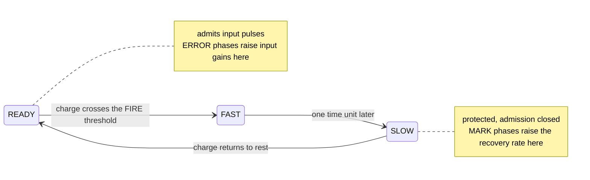

# kernel-R

[](https://github.com/HevisNico/kernel-R/actions/workflows/lean.yml)
[](https://github.com/HevisNico/kernel-R/actions/workflows/recursive-learning.yml)

**Current release** [v0.5.0](https://github.com/HevisNico/kernel-R/releases/tag/v0.5.0) · **Zenodo archive (all versions)** [10.5281/zenodo.23884521](https://doi.org/10.5281/zenodo.23884521)

Kernel R is a mathematical model of an asynchronous analog learning cell.
Its Lean 4 proofs start from the cell's differential equations and establish
what networks of these cells learn. A proved supervisor keeps a degrading
task in service while staying able to detect its next error. A
transistor-level simulation of one cell tests the mechanism, and the proved
results are applied to it port by port where its measured margins allow.
There is no chip.

## In plain words

Analog chips can learn with very little energy, but two chips built from
the same design never behave quite alike. Train them the same way and
they end up with different memories.

Kernel R is a design for a small learning unit, called a cell, that
removes two causes of this, and can say in advance when it will succeed.

- **How much a pulse teaches.** A cell learns by letting a small charge
  drain between two fixed levels. The amount learned depends only on
  those two levels. A slower cell takes longer and learns the same
  amount.
- **When to stop.** A cell trained with identical pulses stops learning
  by itself once its gain supports firing from rest. No final memory
  value is tuned by hand.
- **Knowing in advance.** From margins measured on a cell, a theorem
  says whether that cell will learn in exactly the predicted number of
  pulses. In simulation it has never been wrong where it gave that
  guarantee.
- **Staying verifiable.** A supervisor keeps a task in service while it
  degrades, at a fraction of the cost of constant checking, without
  giving up the observations that reveal its next error. When its own
  assumption breaks, it sees it and stops instead of claiming safety.

Everything below is a theorem checked by a computer, or a simulation
result marked as such.

## Main results

| Result | Kind | Where |
|---|---|---|
| One pulse adds a fixed dose to the memory, whatever the discharge rate, with ±10% fabrication variation | Lean | [`training_read_every_complete`](research/recursive-learning/native/Thresholds/ParameterTraining.lean) |
| Training with identical pulses stops by itself, for any start gain and a firing level from 0.95 to 1.05 | Lean | [`stop_training_exists`](research/recursive-learning/native/Training/TrainingLoop.lean) |
| A given chip has one behaviour: complete runs from the same start agree | Lean | [uniqueness](proof/lean/KernelR/HybridParameterUniversalExecution.lean) |
| Networks of trained cells of any size do what the single-cell descriptions say | Lean | [`acyclic_network_states`](research/recursive-learning/native/Network/AcyclicNetwork.lean) |
| Two trained cells decide whether two signals arrive together | Lean | [`trained_coincidence_network`](research/recursive-learning/native/Training/TrainedCoincidence.lean) |
| `2k + 1` cells find a hidden number among `2^k` | Lean | [`successive_search`](research/recursive-learning/native/Search/SuccessiveSearch.lean) |
| The need of a port stays exact under errors on the start gain, every dose and the firing level, within half a dose in total | Lean | [`needAlong_of_cumulative_tolerance`](research/recursive-learning/native/Search/VariableNeedTolerance.lean) |
| A transistor-level cell trains and stops by itself; 22 of 24 registered checks and predictions hold | simulation | [circuit study](research/circuit/README.md) |
| On 200 new simulated ports, 37 are certified from margins measured on their own runs; all 37 counts are the predicted ones | simulation + Lean | [certification](research/circuit/certification-unconditional/REPORT_AMENDMENT_1.md) |
| A supervisor keeps a degrading task in service from dated, bounded-error observations, with proved service and cost bounds; in preregistered runs it misses no dangerous period at 44% (known ceiling) and 40% (learned ceiling) less cost than constant checking, and detects a broken assumption within one period | Lean + discrete experiments | [supervisor](research/self-certifying-learning/README.md) |
| A controller is reused over any number of native rounds with an exact input cost, and adapts its own search without degrading its true cost, under an assumed evaluator precision | Lean | [reusable controller](research/reusable-controller/README.md) |

| Word | Meaning here |
|---|---|
| Pulse | A short input signal lasting one time unit |
| Port | One of a cell's three inputs |
| Gain | How strongly a port's pulses charge the cell. This is the memory |
| FIRE | The pulse a cell emits when its charge reaches its firing level |
| ERROR phase | The part of a sensor's discharge that raises a gain |
| Dose | The fixed amount that one ERROR phase adds to a gain |
| Need | The number of doses a port must receive before a pulse makes its cell fire |
| Complete run | An execution with no pending event left at its end time |

## The R cell

While ready, an R cell charges in response to input pulses. When its
charge crosses the firing threshold, it emits a pulse and enters a
protected recovery phase.



Each input port has a sensor that sees every pulse and cycles through
READY, MARK, SILENT and ERROR. A complete ERROR phase raises the
log-gain of its port by

```text
Δz = 8 × (entry − exit)
```

where `entry` and `exit` are the two thresholds of the phase. The
discharge rate sets how long the phase lasts and cancels from the
update. The sensor itself ends the update at the exit threshold, so
there is no clock and no controller.

See the [cell laws](model/CELL.md) and the [glossary](docs/GLOSSARY.md).

## What is proved

**A fixed dose.** A single cell trained by one pulse fires on a later
read of the same port, in every complete run, with ±10% fabrication
variation and ±5% on the thresholds. A common shift of both ERROR
thresholds leaves the dose unchanged.
[`training_read_every_complete`](research/recursive-learning/native/Thresholds/ParameterTraining.lean)

**Training stops by itself.** A pulse that leaves the cell silent writes
one dose. A pulse that makes it fire writes nothing, because the write
falls inside the refractory period. Training ends at a gain set by the
cell's own firing level. Two trained ports read together fire later than
0.239 units after the first read pulse and no later than 0.256 units
after the second.
[`stop_training_exists`](research/recursive-learning/native/Training/TrainingLoop.lean) ·
[`OpenCell.read`](research/recursive-learning/native/Network/FreeRead.lean)

**One chip, one behaviour.** For any finite network with fixed parameters
and wires, two runs from the same start that are complete through the
same date have the same end state and the same firing dates.
[uniqueness](proof/lean/KernelR/HybridParameterUniversalExecution.lean)

**Cells compose.** The description of each cell alone gives a complete
run of any network with forward wires, with the same firing dates and
final memories in every complete run. Chains of trained cells are proved
for every length.
[`acyclic_network_states`](research/recursive-learning/native/Network/AcyclicNetwork.lean) ·
[`trained_wired_network`](research/recursive-learning/native/Network/WiredNetwork.lean)

**Coincidence.** Two cells with their own parameters, trained as above,
fire within 0.15 units of each other exactly when they are read at the
same date. A write that applies a fixed current for a fixed time fails
one admissible trial for every current and duration.
[`trained_coincidence_network`](research/recursive-learning/native/Training/TrainedCoincidence.lean) ·
[`coincidence_exit_001_separation`](research/recursive-learning/native/Coincidence/CoincidenceSeparation.lean)

**Search.** The hidden number is the need of a port. One probe and one
gate per depth, and a learner, give the binary digits of the need; the
learner receives exactly that many doses.
[`successive_search`](research/recursive-learning/native/Search/SuccessiveSearch.lean) ·
[map of the results](research/recursive-learning/native/README.md#map-of-the-stop-learning-results)

**Tolerance.** If the errors on the start gain, on every dose and on the
firing level stay below half a dose in total, the need is exact.
[`needAlong_of_cumulative_tolerance`](research/recursive-learning/native/Search/VariableNeedTolerance.lean)

The shared regime: firing level between 0.95 and 1.05, ERROR entry
between 0.07 and 0.08, dose at most 1/20 for the read windows (3/50 for
the [wider windows](research/recursive-learning/native/Training/WideDoseRead.lean)),
pulses at least 22 units apart, other parameters within ±10%.

## From the model to a circuit

*Simulations in the SkyWater 130 nm process with ngspice. No chip, no
layout. Predictions were dated before the runs.*

**The mechanism.** A transistor-level cell with two ports trains and stops
by itself across mismatch, noise, corners and temperature, in a campaign
of 141 runs with none abandoned. Under a leak it maintains itself: one silent pulse rewrites
a dose about every 22 periods. 22 of 24 registered checks and predictions
hold; the two that fail are a sigma limit set too tight and a range of
silent pulses set too narrow.
[circuit study](research/circuit/README.md) ·
[verdicts](research/circuit/VERDICTS.md)

**Certification.** On 100 new cells (200 ports), the tolerance theorem
is applied to each port with bounds measured on its own run.

| Step | Ports certified | Counts contradicted |
|---|---|---|
| Margins measured, two conditions declared | 59 | 0 |
| Threshold offset measured on each cell | 58 | 0 |
| Gain also measured independently, as amended before the test runs | 37 | 0 |

The threshold offset of every one of the 100 cells lies inside the
calibration envelope, as the first campaign assumed. The gain measure
registered first certifies no port, because the mirror current changes
after a FIRE; a corrected measure, declared before the test runs,
certifies 37. Every port whose count differs from the prediction is
outside the certified domain: most start close to a boundary between two
needs, where the theorem gives no guarantee.
[first campaign](research/circuit/certification/REPORT.md) ·
[measured conditions](research/circuit/certification-unconditional/REPORT_AMENDMENT_1.md) ·
[circuit-to-model bridge](research/circuit/lean/README.md)

## A controller that is reused and adapts

A teaching controller is closed natively in R cells: under a fixed
calendar, a read returns to rest and is prepared again, for any number
of rounds, with exactly three input deliveries per round in every
complete run.
A second level chooses among search policies. The evaluator and the
acceptance rule are outside what it can change, and a policy is adopted
only if it beats the current one by more than twice the evaluator's error
bound, so the true cost never increases. That error bound is assumed in
the general theorems.
[`calendar_rounds_exists`](research/recursive-learning/native/Teaching/SelectorRounds.lean) ·
[adaptive search](research/reusable-controller/ADAPTIVE.md) ·
[physical bridge](research/reusable-controller/physical/README.md)

## A supervisor that stays verifiable

A task loses reserve under a leak and is repaired by doses. A supervisor
decides when to observe and when to repair. Lean proves, for the plan it
generates from dated bounded-error observations, that service holds at
every time of the accepted plan and that the number of writes is bounded.
A stale observation is refused, never redated, and every contract expires
at a horizon fixed in advance, so the supervisor cannot save cost by
looking less. A fixed fallback is always available under a hard loss
ceiling.
[`system_safe`](research/self-certifying-learning/SelfCertifyingLearning/OfferFactory.lean) ·
[`perpetual_service`](research/self-certifying-learning/SelfCertifyingLearning/Availability.lean)

Three discrete experiments, each preregistered before implementation and
run once, test it against a naive controller, which spaces its probes as
long as it sees no failure, and a prudent one, which probes every period.
The leak jumps at a date the controllers do not know.

| Run | Supervisor | Prudent | Naive | Result |
|---|---|---|---|---|
| [v1](research/discrete-refresh-experiment/run-v1/REPORT.md): leak ceiling known | 1 247, no missed danger | 2 211 | 1 014, 759 dangerous periods unseen | 44% cheaper than prudent |
| [v2](research/adaptive-refresh-experiment/run-v2/REPORT.md): ceiling estimated from observations under a bounded-variation law | 1 325, no missed danger | 2 211 | 1 014, 739 dangerous periods unseen | 40% cheaper than prudent, 6% above v1 |
| [v3](research/refresh-contract-rupture/run-v3/REPORT.md): the leak jumps from 10 to 140, beyond that law | detected one period after the jump, contract refused | | | no false safety declaration |

The naive controller is cheapest because it observes least, and it is
the one that misses danger. The leak and the dose of these runs match
the refresh records of the circuit
([calibration](research/adaptive-refresh-experiment/R_CALIBRATION.md)).

## Limits

- **Simulation, not hardware.** The circuit results are simulations of
  one cell; no device was measured.
- **The joint read of the circuit** fires near 0.267 units, outside the
  window proved for the model, (0.239, 0.256].
- **Ideal timing signals.** The simulated cell takes the arrival of each
  pulse from ideal signals; it does not detect pulses itself.
- **Certification is per port and conditional on a simulation.** The
  threshold of a cell is measured once, on one port; the gain error is
  measured without noise and applied to a noisy run; each count comes
  from one noisy run. Statistical repeatability is not yet measured.
- **Clocked wires.** In the search, a FIRE inside a window releases
  pulses at preset dates, which stands for a clocked register.
- **Exact quantities.** The pulse amplitude, the unit response and the
  MARK and SILENT levels are those of the model.
  [Implementation assumptions](model/IMPLEMENTATION_ASSUMPTIONS.md)
- **Elementary tasks.** The networks hold at every size, on a
  coincidence decision and the search for one number.
- **The supervisor experiments are discrete models.** The variation law
  of v2 is supplied, not learned; v3 stops without recovering; the
  decisions come from Lean lemmas, but the experiment wrapper has no
  end-to-end proof; the link to the circuit is a nominal calibration.

## History

| Version | Date | What it added |
|---|---|---|
| [v0.1.0](https://github.com/HevisNico/kernel-R/releases/tag/v0.1.0) | 2026-10-30 | Robust composition of N cells |
| [v0.2.0](docs/RELEASE_V0_2_0.md) | 2026-11-02 | A chain of any length learns the same amounts in every cell |
| [v0.3.0](docs/RELEASE_V0_3_0.md) | 2026-11-10 | Learning with realized thresholds; the coincidence decision and its benchmark |
| [v0.4.0](docs/RELEASE_V0_4_0.md) | 2026-11-11 | Training that stops by itself, networks of trained cells, searches |
| [v0.5.0](docs/RELEASE_V0_5_0.md) | 2026-11-13 | Circuit simulation, certification on measured margins, reusable and adaptive controller, a supervisor that stays verifiable |

The [registered benchmark](research/recursive-learning/COINCIDENCE_BENCHMARK.md)
of v0.3.0 compares write rules on the coincidence task; every Kernel R
setting scored above the best tested constant-current write. All versions:
[releases](docs/RELEASES.md).

## Related work

Rate-independent charge increments, stop-learning rules, run-time
contracts and formal verification of spiking networks all have
precedents. Kernel R studies a particular combination: a sensor discharge
between two state thresholds sets the dose, the protected phase after a
FIRE blocks the write, and Lean connects those dynamics to training,
composition, and certification of simulated devices.
[Comparison and references](docs/RELATED_WORK.md)

## How to check it

The project pins **Lean 4.35.0** and **Mathlib v4.35.0**.
Run each block from the repository root.

```sh
cd proof/lean
lake exe cache get
lake build
lake build Audit
```

```sh
cd research/recursive-learning/native
lake exe cache get
lake build
```

Every audit allows only `propext`, `Classical.choice` and `Quot.sound`
and fails on admitted proofs. Each research package has its own build,
audit and CI workflow; see its README. The circuit reports regenerate
from the committed results.
[Validation ledger](docs/VALIDATION_LEDGER.md) ·
[reviewer's reading path](REVIEW.md)

## Repository map

| Folder | Contents |
|---|---|
| [`model/`](model/README.md) | Cell laws and the chain protocol |
| [`proof/lean/`](proof/lean/README.md) | Core Lean development and audit |
| [`research/recursive-learning/`](research/recursive-learning/README.md) | Trained cells, networks, searches, tolerance |
| [`research/circuit/`](research/circuit/README.md) | Transistor-level simulation, certification campaigns, circuit-to-model bridge |
| [`research/reusable-controller/`](research/reusable-controller/README.md) | Reusable and adaptive controller, physical bridge |
| [`research/self-certifying-learning/`](research/self-certifying-learning/README.md) | Supervisor proofs; its experiments are in `discrete-refresh-experiment`, `adaptive-refresh-experiment` and `refresh-contract-rupture` |
| [`research/`](research/README.md) | All research packages |
| [`docs/`](docs/UNIVERSAL_FINITE_CHAIN.md) | Theorem guides, trusted base, provenance, releases |
| [`archive/`](archive/README.md) | Earlier experiments and specifications |

## Origin, AI assistance and license

This work draws inspiration from Nicolas Breuillaud's
[*The Reset Operator: A Structural Constraint on Recursivity*](https://ssrn.com/abstract=6964960).

Nicolas Breuillaud directs the work with assistance from **Claude**
(Anthropic) and **ChatGPT** (OpenAI) on models, code, proofs and
documentation. Lean checks the proof terms against their definitions and
hypotheses. Physical assumptions and claims outside those proofs remain
subject to independent review.

Source code is [MIT](LICENSE). Documents, proofs, data and other non-code
material are CC BY 4.0 under [LICENSE-docs.md](LICENSE-docs.md).
