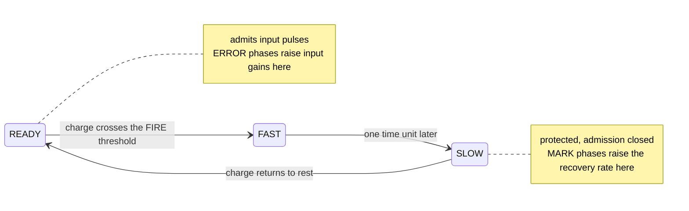

# kernel-R

[](https://github.com/HevisNico/kernel-R/actions/workflows/lean.yml)
[](https://github.com/HevisNico/kernel-R/actions/workflows/recursive-learning.yml)

**Current release** [v0.3.0](https://github.com/HevisNico/kernel-R/releases/tag/v0.3.0) · **Zenodo archive (all versions)** [10.5281/zenodo.23884521](https://doi.org/10.5281/zenodo.23884521)

Kernel R is a mathematical model of an asynchronous analog learning cell.
Its Lean 4 proofs start from the cell's differential equations and establish
what networks of these cells learn. The work is at the model stage.

## In plain words

Analog chips can learn with very little energy, but two chips built from
the same design never behave quite alike. Train them the same way and
they end up with different memories.

Kernel R is a design for a small learning unit, called a cell, that
removes one cause of this. A cell learns by letting a small charge drain
between two fixed levels. How much it learns depends only on those two
levels. A slower cell takes longer and learns the same amount.

This repository contains no chip. It contains the cell's equations and
proofs, checked by a computer, of what cells and small networks do.

**What the design gains**

- **The amount learned ignores the discharge rate.** A ±10% spread in
  that rate changes how long learning takes and leaves its result alone.
- **No clock and no controller.** The sensor ends each update itself
  when its charge reaches the lower level.
- **One chip, one behaviour.** Simultaneous events can be processed in
  any legal order without changing the outcome.
- **It composes.** Chains of any length learn the same amounts on every
  chip within the declared variation.
- **It beats the standard write on a timing task.** Two cells detect that
  two signals arrive together. A write that applies a fixed current for a
  fixed time provably fails that task under the same variation.

| Word | Meaning here |
|---|---|
| Pulse | A short input signal lasting one time unit |
| Port | One of a cell's three inputs |
| Gain | How strongly a port's pulses charge the cell. This is the memory |
| Threshold | A charge level that triggers a change of phase |
| ERROR phase | The part of a sensor's discharge that raises a gain |
| Complete run | An execution with no pending event left at its end time |

The sections below state each result with its exact conditions.

## The R cell

While ready, an R cell charges in response to input pulses. When its
charge crosses the firing threshold, it emits a pulse and enters a
protected recovery phase. It learns each port's input gain while
ready and its recovery rate while protected.



Each input port has a sensor that sees every pulse and cycles through
READY, MARK, SILENT and ERROR.

Fabrication mismatch can make the same training pulse produce different
updates in nominally identical devices. Kernel R couples a sensor's
discharge to a memory update. When a complete ERROR phase stays eligible
and the gain remains below its cap, the increase in log-gain is

```text
Δz = 8 × (entry − exit)
```

The discharge rate changes how long the phase lasts and cancels from the
update. The sensor itself ends the update at the exit threshold. With
nominal thresholds 0.1 and 0.025, the increment is 0.6. A full MARK phase
while the cell stays protected adds 0.1 to its recovery rate at nominal
thresholds, provided the learning gates stay open and the rate stays
below its cap.

See the [cell laws](model/CELL.md) and the [glossary](docs/GLOSSARY.md).

## What is proved

### 1. Chains of any finite length learn the same increments

*Every cell in a chain ends up with the same amount learned, on every chip.*

Under the [chain protocol](model/CHAIN_PROTOCOL.md), every complete run
raises each cell's active input log-gain by 2.4 and its recovery rate by 0.3.
The increments hold across independent fixed fabrication variation of up to
±10% and bounded wire jitter. For each fixed choice of parameters, birth
data and delays, complete runs agree on each cell's ordered firing dates
regardless of the legal order of simultaneous events. Lean constructs a
complete run in both first-contact and upward-crossing semantics. The
root ends with at least eight pulses, each within 0.15 model units of a
period-four rhythm.

Each cell first receives its own preparation train while the links are off,
which writes three of a relay's four active-port doses. The links then open,
the leaf receives a regular source rhythm, and each relay receives its
fourth dose from its neighbour. The theorem uses nominal thresholds and
the declared birth bounds, including `10⁻⁵` tolerances on the initial
charges, log-gains and recovery rate.

[`TrustedHeadline.every_finite_chain`](proof/lean/KernelR/TrustedHeadline.lean) ·
[theorem guide](docs/UNIVERSAL_FINITE_CHAIN.md) ·
[trusted definitions](docs/TRUSTED_BASE.md)

### 2. Thresholds are parameters, and runs stay unique

*Even with imperfect thresholds, a given chip has only one possible behaviour.*

Charge thresholds are fields of each cell's parameters. For any finite
network, under the declared physical and threshold bounds, compare two
finite first-contact runs from the same initial snapshot with the same
realized parameters and fixed router. If both are complete through the
same horizon, they have the same endpoint up to pending-list order and the
same ordered firing dates in each cell.

[semantics](proof/lean/KernelR/HybridParameterExecution.lean) ·
[uniqueness](proof/lean/KernelR/HybridParameterUniversalExecution.lean)

### 3. One training pulse and one read tolerate threshold error

*One pulse is enough to teach a cell, and the lesson survives threshold error.*

A single cell trained by one pulse fires on a later read of the same port
in every run complete through the certified read horizon. With the ERROR
exit centered at 0.025, the theorem allows ±5% on both ERROR thresholds and
FIRE. A separate instance lowers the nominal exit to 0.01 and reads later.
That gives a larger dose (0.72 at nominal thresholds) and a longer
discharge. The same absolute threshold errors account for a smaller
fraction of the larger dose.

Two refinements separate what changes the dose from what does not. A
shift common to both ERROR thresholds, up to 4% of the entry level,
leaves the increment unchanged. A fixed reaction delay `d` after each
threshold crossing moves the increment by at most `2.4 × d`.

[`training_read_every_complete` and `training_read_exit_001_every_complete`](research/recursive-learning/native/ParameterTraining.lean) ·
[`training_read_common_offset` and `training_read_reaction_delay`](research/recursive-learning/native/OffsetAndDelay.lean)

### 4. Two cells learn a coincidence task

*Two cells detect that two signals arrive together. A fixed-current write cannot.*

Two cells each learn one of two ports. At 100 µs per model unit, the
receiver requires exactly one report from each cell by the deadline,
with their arrivals less than 15 µs apart. Lean proves that this happens
exactly when both test ports match the training and the programmed input
offset is zero. The benchmark timing is motivated by a published task.

- **Kernel R meets the full contract.** A complete run exists for each
  admissible trial and every complete run gives the expected decision.
  At 100 µs per model unit, the guarantee covers ±10% fabrication,
  ±3% FIRE error and absolute variation of up to 0.001 at ERROR entry and
  0.00025 at ERROR exit on each trained port.
- **The reduced constant-current comparator fails.** With ±10% current
  variation and nominal ERROR endpoints, one admissible positive trial
  fails for every shared current and duration, including settings that
  reach the gain cap.

The R proof uses native hybrid executions with realized thresholds. The
comparator proof uses the reduced read model, with an eligible write and
quiet charge relaxation after training.

[`coincidence_exit_001_separation`](research/recursive-learning/native/CoincidenceSeparation.lean) ·
[module guide](research/recursive-learning/native/README.md#coincidence-timing-with-an-error-exit-near-001)

### 5. Training that stops by itself replaces the hand-set gain

Result 4 assumes a trained-port birth gain of exactly 1.2 and a FIRE
level within ±3%. Here neither is set by hand. Each port receives a train
of identical pulses. A pulse that leaves the cell silent writes one dose,
and a pulse that makes it fire writes nothing, because the write phase
then falls inside the refractory period. Training therefore stops by
itself at a gain that depends on the cell's own FIRE level.

- **One cell.** Two ports start from any gains that do not fire. After
  training, one pulse on each port reads the cell, in either order, at
  most a quarter of a unit apart. The cell fires later than 0.239 units
  after the first read pulse and no later than 0.256 units after the
  second, for every FIRE level between 0.95 and 1.05 and ±10%
  fabrication. Every complete run has the same FIRE dates.
- **Two cells.** Each cell has its own parameters, start gains and FIRE
  level. In every complete run of the two-cell network, the two read
  FIRE dates are closer than 0.15 units exactly when the two cells are
  read at the same date, among offsets of −0.3, 0 and +0.3 units.
- **Networks.** Any number of trained cells can be joined by wires that
  go forward. One composition theorem turns the description of each cell
  alone into a complete run of the network, and proves that every
  complete run has the same FIRE dates and the same final values. A
  chain of `n` trained cells, each read by the FIRE of the one before
  it, is proved for every `n`.
- **A witness.** Explicit cells and schedules satisfy the hypotheses of
  each theorem.

The dose of each port is set by its two ERROR thresholds, with a dose of
at most 1/20 for the stated window. The ERROR entry threshold is lowered
to between 0.07 and 0.08, so that the write starts after the pulse has
ended. The proofs handle the sensor contacts and the end of the
refractory period in whatever order they occur. The comparison with a
constant-current timer of result 4 is not redone with trained cells.

[`OpenCell.read`](research/recursive-learning/native/FreeRead.lean) ·
[`trained_coincidence_network`](research/recursive-learning/native/TrainedCoincidence.lean) ·
[`acyclic_network_states`](research/recursive-learning/native/AcyclicNetwork.lean) ·
[`trained_wired_network` and `trained_chain_witness`](research/recursive-learning/native/WiredNetwork.lean) ·
[map of the results](research/recursive-learning/native/README.md#map-of-the-stop-learning-results)

### 6. A binary search for a hidden need, with trained cells only

A port needs `m` doses before a pulse makes its cell fire. That need is
a property of the cell: its start gain, its dose and its FIRE level. A
probe cell that receives `c` training pulses and then a read pulse fires
on the read exactly when `m ≤ c`. This replaces the exact birth gain of
the count probe in the
[adaptive teaching loop](research/recursive-learning/native/README.md#a-threshold-probe-with-excess-pulses).

- **Acting on silence.** A trained cell read by one pulse fires later
  than 0.355 units after it. Read by two pulses it fires before 0.256
  units. A gate cell read by a clock pulse, and by the report of a probe
  when there is one, therefore fires late exactly when the probe was
  silent.
- **A tree of questions.** For every `k`, a tree of `2^k − 1` questions
  separates the needs 1 to `2^k`. A run asks `k` of them, one at each
  depth, and the probes off that path receive no pulse.
- **Successive approximation.** The same search runs with `2k + 1`
  cells: one probe and one gate for each depth, and a learner. Each gate
  that answers no adds its binary weight to the later questions. The
  gates give the binary digits of `m − 1`, the learner receives exactly
  `m` training pulses, and the run ends at the date
  `1003 + 33 · 2^k + 25k`.
- **Tolerance.** A probe keeps the need `m` when the errors `a` on its
  start log-gain, `b` on its dose and `ℓ` on its FIRE level satisfy
  `a + m·b + (20/17)·ℓ + 1/8000 < d₀/2`, for a nominal dose `d₀`. The
  dose error counts `m` times. For a dose of 1/20 known to 1%, needs up
  to 49 are separated.

A FIRE inside a report window releases pulses at preset dates, as in the
scheduled circuits of the adaptive-teaching results. A FIRE date is read
only through its window.

[`self_calibrated_probe_exists`](research/recursive-learning/native/SelfCalibratedProbe.lean) ·
[`signal_network_states`](research/recursive-learning/native/SignalNetwork.lean) ·
[`trained_search`](research/recursive-learning/native/TrainedSearch.lean) ·
[`bisection_search`](research/recursive-learning/native/BisectionSearch.lean) ·
[`successive_search` and `successive_search_witness`](research/recursive-learning/native/SuccessiveSearch.lean) ·
[`needIs_of_tolerance`](research/recursive-learning/native/NeedTolerance.lean) ·
[map of the results](research/recursive-learning/native/README.md#map-of-the-stop-learning-results)

## What the benchmark showed

*Writing the memory from the sensor's own discharge beat the standard
constant-current write. Ending that discharge at a threshold did it
without a clock.*

The protocol and its predictions were registered before the sweeps. Each
score counts passing combinations of ERROR and FIRE threshold error, out
of 36, at 100 µs per model unit in the wide (±10%) fabrication box. The
constant-current row uses ±10% current error. These are numerical results
on 625 sampled points.

| Write rule | Needs a clock | Score |
|---|---|---:|
| Constant current, best tested setting | yes | 12 |
| Timed discharge, same duration as R (0.15) | yes | 8 |
| **Kernel R**, exit 0.025 | no | 16 |
| **Kernel R**, exit 0.01 | no | 22 |
| **Kernel R**, exit 0.0025 | no | 23 |
| Timed discharge, 0.4 or longer | yes | 27 |

- **Discharge against constant current.** Every Kernel R setting scores
  above the best tested constant-current write. Result 4 turns one of
  these cases into a theorem covering every constant-current setting.
- **Threshold against timer, at equal duration.** Kernel R passes 16
  cases where a timer of the same length passes 8. The timer cuts slow
  devices short and the threshold waits for them.
- **Threshold against a long timer.** A timer long enough for the slowest
  device reaches 27. Kernel R reaches 22 to 23 with a lower exit and no
  timer. The remaining gap comes from the error of the exit threshold,
  which the timed write does not have.
- **Cost of a lower exit.** The ERROR phase lengthens from 0.15 to between
  0.25 and 0.40 model units, and the nominal number of levels below the
  gain cap falls from three to two.

A constant-current write that saturates at the gain cap passes all 36
cases when caps are held within ±0.3%, and 12 in the wide box. It stores
a single level.

[protocol](research/recursive-learning/COINCIDENCE_BENCHMARK.md) ·
[numerical results](research/recursive-learning/coincidence/RESULTS.md) ·
[exit-threshold sweep](research/recursive-learning/coincidence/EXIT_TRADEOFF_RESULTS.md)

## Scope

- **A mathematical model.** Hardware measurements would be needed for
  experimental validation.
- **Small tasks.** The networks and searches of results 5 and 6 hold at
  every size, on tasks that stay elementary: a coincidence decision and
  the search for one integer. The
  [exact counting theorem](docs/EXACT_DOSE_COUNTING.md) uses nominal
  thresholds.
- **Exact quantities.** Actuation factors are exact. Result 4 uses a
  trained-port birth gain of exactly 1.2 and a FIRE threshold within
  ±3%. These are modelling choices, and no circuit evidence supports them
  as worst-case bounds. Results 5 and 6 remove both: their start gains
  are free and their FIRE levels lie anywhere between 0.95 and 1.05.
  Their pulse amplitude, unit response, MARK and SILENT levels are still
  those of the model, their recovery rates lie between 0.07 and 0.10,
  and their pulses are at least 22 units apart. See the
  [implementation assumptions](model/IMPLEMENTATION_ASSUMPTIONS.md).
- **Clocked wires.** In result 6 a signal releases pulses at preset
  dates. This hides a clocked register in the wire. A cell that would
  resynchronize a pulse is not built.
- **Dose precision.** Separating `2^k` needs asks for a dose error below
  about `d₀ / 2^(k+1)`.
- **Receiver.** The coincidence receiver is a decision rule on the
  two cells' emitted dates.
- **Complete runs.** Theorems compare runs complete through a horizon.
  A delivery due before the previous pulse expires on the same port blocks
  completion through that date. The declared tasks have complete witnesses.

The native guide covers [binary search for a hidden need](research/recursive-learning/native/README.md#searching-for-an-unknown-need),
[reuse of a learned choice](research/recursive-learning/native/README.md#reusing-a-learned-choice-in-two-rounds)
and the [8 → 7 → 6 teaching loop](research/recursive-learning/native/README.md#the-8--7--6-experiment-with-learner-readouts).
See also [chain progress](proof/lean/PROGRESS.md) and
[port-memory saturation](docs/GAIN_MEMORY_SATURATION.md).

## Related work

Analog synaptic increments that contain no discharge rate already exist.
The closest precedent we examined is the switched-capacitor synapse of
Noack et al., whose step is set by a capacitor ratio and control voltages
in a clocked circuit. Kernel R integrates a self-timed discharge between
two state thresholds and machine-checks how the updates compose.
[Noack et al.](https://www.frontiersin.org/journals/neuroscience/articles/10.3389/fnins.2015.00010/full) ·
[full comparison](docs/RELATED_WORK.md)

## How to check it

The project pins **Lean 4.35.0** and **Mathlib v4.35.0**.
Run each block from the repository root.

```sh
cd proof/lean
lake exe cache get
lake build
lake build Audit
```

```sh
cd research/recursive-learning/native
lake exe cache get
lake build
```

The core audit and the native package's default audit allow only
`propext`, `Classical.choice` and `Quot.sound` and fail on admitted proofs.
See the [validation ledger](docs/VALIDATION_LEDGER.md).

The [reviewer's reading path](REVIEW.md) starts with how the Lean
definitions represent the written model.

## Repository map

| Folder | Contents |
|---|---|
| [`model/`](model/README.md) | Cell laws and the chain protocol |
| [`proof/lean/`](proof/lean/README.md) | Core Lean development and audit |
| [`research/`](research/README.md) | Tolerant training, coincidence proofs and benchmark |
| [`docs/`](docs/UNIVERSAL_FINITE_CHAIN.md) | Theorem guides, trusted base, provenance |
| [`archive/`](archive/README.md) | Earlier experiments and specifications |

## Origin, AI assistance and license

This work draws inspiration from Nicolas Breuillaud's
[*The Reset Operator: A Structural Constraint on Recursivity*](https://ssrn.com/abstract=6964960).

Nicolas Breuillaud directs the work with assistance from **Claude**
(Anthropic) and **ChatGPT** (OpenAI) on models, code, proofs and
documentation. Lean checks the proof terms against their definitions and
hypotheses. Physical assumptions and claims outside those proofs remain
subject to independent review.

Source code is [MIT](LICENSE). Documents, proofs, data and other non-code
material are CC BY 4.0 under [LICENSE-docs.md](LICENSE-docs.md).
