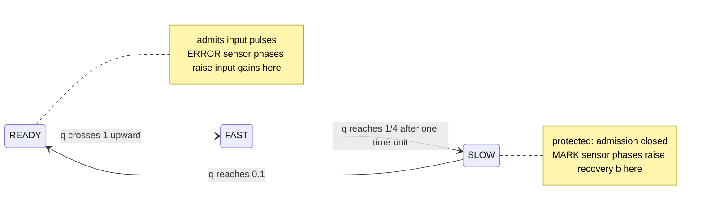

# kernel-R

[](https://github.com/HevisNico/kernel-R/actions/workflows/lean.yml)

[](https://github.com/HevisNico/kernel-R/actions/workflows/recursive-learning.yml)

**Archived release v0.2.0 — DOI:** [10.5281/zenodo.23884521](https://doi.org/10.5281/zenodo.23884521)

## Why it matters

Kernel R makes learning exactly predictable in a model of asynchronous cells
with fabrication mismatch. In every complete run of the declared protocol,
each cell's memory increments are the same across the allowed fabrication
parameters, wire delays and legal orders of simultaneous events. Lean proves
this from the cell's differential equations for chains of any finite length.

The same cells can also run a teaching loop. In a fixed network of nine R
cells, learners' measured physical state drives acceptance, a failed probe
drives a selector update, and the network delivers lessons of 8, then 7,
then 6 pulses. Cutting the single feedback wire removes the second
improvement. Lean proves these outcomes for complete upward-crossing runs
at the protocol horizon, with independent fixed fabrication variation of up
to ±10% in every cell.

During a full learning phase, the cell integrates a sensor's discharge between
fixed charge thresholds. The fabrication rate cancels from the dose.

- A complete ERROR phase adds `Δz = 8 × (0.1 − 0.025) = 0.6` to the port's
  log-gain when the cell stays READY.
- A complete MARK phase contributes `(1 − 0.8) / 2 = 0.1` to the cell's
  recovery rate when the cell stays protected. Contributions from different
  ports add together.

These exact increments require positive energy and an open cap gate for the
relevant memory throughout the phase. No external controller computes the
learning updates.

> **Scope of the robustness.** Each port's gain cap, sensor rates and sensor
> input gain (`C, L_m, L_s, L_e, M`) may vary across cells and ports, with
> values fixed in time. Thresholds and actuation factors are exact.

## An R cell in one picture



The cell emits one pulse at the start of FAST. The pulse lasts one time
unit, and main-cell input admission stays closed throughout FAST and SLOW.
Each of its three input ports has a sensor that sees raw pulses even during
protection and cycles through READY → MARK → SILENT → ERROR → READY.

The log-gain `z` can change while the main cell is READY. The recovery rate
`b`, which governs SLOW decay, can change while the main cell is protected.

See the [cell laws](model/CELL.md) and [glossary](docs/GLOSSARY.md).

## Result 1: every finite chain learns exactly

**In plain words.** Take a chain of any positive finite length. Choose its
fabrication parameters independently within the ±10% or ±0.3% box and start
every cell in READY, near its nominal resting values. Send each cell a
preparation train, then drive the leaf with a regular rhythm. Each link
delivers pulses with a delay in `[0.3, 0.4]`. The delay functions are fixed
in advance and may vary over time, with summed jitter budgets at most 0.15.

With these inputs fixed, the theorem gives the following guarantees.

- **A complete run exists** in the model's upward-crossing semantics.
- **Every complete run agrees** on the physical endpoint and each cell's
  ordered firing dates, regardless of the legal order of simultaneous events.
- **Each cell learns exactly.** Its active input log-gain ends at its birth
  value + 2.4, and its recovery rate ends at its birth value + 0.3.
- **The rhythm crosses the chain.** The root's output ends with at least eight
  pulses at dates `τ + 4k + η_k`, with `|η_k| ≤ 0.15`.
- **The chain ends READY.** At the horizon every main unit and sensor is READY,
  each main charge is 0.1, and no pulse current or delivery remains.

**Formally.** The Lean statement is
[`TrustedHeadline.every_finite_chain`](proof/lean/KernelR/TrustedHeadline.lean),
whose meaning is fixed by a machine-checked list of definitions, the
[trusted base](docs/TRUSTED_BASE.md).

> For every positive finite chain length N, every admissible source length K,
> all independent fixed fabrication parameters and READY birth data, and every
> admissible family of bounded wire-delay functions fixed in advance, the
> fixed chain router admits a complete physical execution in both semantics.
>
> Every finite execution in either semantics, from the same birth data and
> complete through the same horizon under that router, has the same physical
> endpoint and the same ordered firing dates in every cell.

The [finite-chain specification](model/CHAIN_PROTOCOL.md) gives the exact
birth bounds, source length `K ≥ 4N + 12`, and delay assumptions. The
[theorem guide](docs/UNIVERSAL_FINITE_CHAIN.md#result-every-finite-chain-with-explicit-scope)
gives the detailed outcomes.

The result holds both in the model's upward-crossing semantics and in Lean's
native first-contact semantics, with the
[correspondence between them](docs/MODEL_LEAN_CORRESPONDENCE.md#threshold-contacts-and-upward-crossings)
proved for this protocol. A corollary realizes any prescribed sequence of
bounded per-pulse wire errors on the actual sending firings.

## Result 2: a teaching loop driven by learner readouts

**The question.** Can feedback from a learner change both the next lesson
and which edit the teacher tries after that? A
[discrete model](research/recursive-learning/README.md) states the target:
two successive improvements, from 8 to 7 to 6 pulses, for a learner that
needs three preparation and three practice pulses. Freezing only the
selector keeps the first improvement and prevents the second.

**In plain words.** A fixed network of nine R cells carries out that
experiment with actual R dynamics. Each learner is a fresh R cell whose
input gains record the lesson pulses it has received. Each lesson pulse
in these trials writes a dose of 0.6.

1. A learner receives the full 3 + 4 trial. Its read pulse sees the gain
   that trial wrote. The learner's FIRE writes the preparation credit,
   releases the 7-pulse lesson and launches the 2 + 4 trial.
2. The 2 + 4 learner stays silent at its read. Its silence leaves a
   diagnostic cell exposed, and the diagnostic FIRE writes the selector.
3. The selector's read sees that dose. Its FIRE launches the 3 + 3 trial.
   That learner's FIRE writes the practice credit and releases the
   6-pulse lesson.

| Configuration | Lessons delivered | Credit gains | Each lesson meets needs (3, 3) |
|---|---|---|---|
| Feedback wire present | 8, 7, 6 | 0.6, 0.6 | Yes |
| Feedback wire cut | 8, 7 | 0.6, 0 | Yes |

The counts cover deployed lesson pulses. Trials, read pulses, diagnostics
and credit writes use additional pulses.

Both runs start from the same physical snapshot. Actual FIRE events launch
the later trials, issue the credit and feedback pulses, and release the
seven- and six-pulse lessons. The initial queue supplies the baseline lesson,
the first trial and its read pulse, the two diagnostic pulses, and the
selector read pulse. The theorem holds in either fabrication box, with
independent fixed parameters for each of the nine cells.

**Formally.** The Lean statement is
[`native_readout_eight_seven_six`](research/recursive-learning/native/ReadoutSeries.lean).

It constructs a complete upward-crossing execution through its horizon with
the lesson counts, retention results and credit gains above. All complete
upward-crossing executions through that horizon agree on the terminal
physical state up to pending-list order and on each cell's ordered firing
dates for the same initial state, parameters and router. Complete
first-contact executions deliver the same tokens up to permutation. The
[native guide](research/recursive-learning/native/README.md#the-8--7--6-experiment-with-learner-readouts)
describes each stage and its local theorems.

**Scope of this result.** The theorem covers this fixed experiment.

- **Candidate shapes and their order are wired.** The router holds the
  3 + 4, 2 + 4 and 3 + 3 trials and the deployed lessons. The firing
  events determine which of these stages runs.
- **Credits and deployed lessons.** The cells write the credits. The router
  supplies the deployed lesson shapes. In the discrete model the lesson is
  the initial lesson minus the credits.
- **Each acceptance reads one block.** The other block already meets its
  requirement in each trial. The discrete model validates against two
  learners.
- **The selector is one-shot**, with fixed clocks and one diagnostic cell.
  A [nondestructive capped read](research/recursive-learning/native/README.md#a-selector-read-that-preserves-the-gain)
  is proved for a separate controller with saturated recovery and a
  prepared ignition gain.

The general credit bound and the abstract learner are established in the
discrete model only.

## Scope and assumptions

- **Complete executions.** Both results compare executions complete
  through a horizon. For the chain, separate [progress theorems](proof/lean/PROGRESS.md)
  extend every legal finite prefix to later horizons and prove time divergence
  for infinite native runs maximal under extension at a finite flow limit.
- **Learning and cadence only for the chain protocol.** Cyclic networks, noise
  or drift during operation, and other protocols have their own
  [coverage boundaries](proof/lean/N_CELL_COVERAGE.md).
- **Teaching only for the stated experiment.** See the scope of Result 2.
- **Dose counts on the constructed run only.** The
  [counting theorem](docs/EXACT_DOSE_COUNTING.md) gives four ERROR phases on
  the active port and three MARK phases across each cell's ports in the
  constructed execution. The universal comparison transfers the resulting
  memory increments to every complete execution.
- **Thresholds held exact.** See the scope note above.
- **Model verification.** The proofs concern the stated equations and
  semantics. Experimental validation would require hardware measurements.
- **The Reset Operator.** The broader saturation argument is a separate result.

## Other proved results

| Result | Scope | Statement |
|---|---|---|
| **Event order does not matter.** Executions complete through the same horizon agree on the physical endpoint up to pending-list order, and on each cell's ordered firing dates. | Native semantics for any finite network, including cycles, with the same parameters, initial snapshot and fixed router, under the physical bounds. | [endpoint and dates](proof/lean/KernelR/HybridUniversalExecution.lean) |
| **Recovery limits the output rate.** If recovery stays at most `β > 0`, two firings of a cell are at least `1 + log(5/2)/β` apart (about 1.833 at the built-in cap). A window of length L contains at most `1 + L/(1 + log(5/2)/β)` firings. | Any topology, both semantics. | [guide](docs/RESET_RATE_SATURATION.md) · [Lean](proof/lean/KernelR/HybridResetRateCrossing.lean) |
| **Zero recovery can lock a cell.** A cell starting in SLOW with charge 1/4 and zero recovery cannot fire again while no sensor spends positive time in MARK. An isolated, fully exposed MARK phase can restore recovery to 0.1. | Any finite network and router. Lock in both semantics, conditional repair in native semantics. | [guide](docs/RESET_ZERO_RECOVERY.md) |
| **Port memory saturates after an exact number of ERROR phases.** After `k` counted phases, the log-gain is `min(log C, z₀ + 0.6k)`. It reaches the cap exactly when `k ≥ ⌈(log C − z₀)/0.6⌉` and stays there in later legal executions. | Any finite network and router in both semantics, under the physical box. The count theorem requires an actual complete section cover and a starting log-gain at or below the cap. | [guide](docs/GAIN_MEMORY_SATURATION.md) · [Lean](proof/lean/KernelR/HybridCrossingMemorySaturation.lean) |

## How to check it

The project pins **Lean 4.35.0** and **Mathlib v4.35.0** ([lake-manifest.json](proof/lean/lake-manifest.json)).

For the chain theorem and the core results:

```sh
cd proof/lean
lake exe cache get
lake build
lake build Audit
```

For the teaching experiment, from the repository root:

```sh
cd research/recursive-learning/native
lake exe cache get
lake build
```

Each package runs its own axiom audit, which allows only `propext`,
`Classical.choice` and `Quot.sound` and fails the build on admitted proofs.

The core source checks also reject added axiom declarations and
`native_decide`. See the
[recorded full validation](docs/VALIDATION_LEDGER.md#full-lean-validation-at-0543640),
[exact signatures and axiom outputs](docs/UNIVERSAL_FINITE_CHAIN.md#lean-headline-signatures-axioms-and-reproduction), and
[fresh-checkout rebuild instructions](proof/lean/README.md#rebuild-project-proofs-without-a-restored-project-cache).

## For reviewers

Lean checks the proofs. Human review starts with whether `CrossingExecution`
faithfully represents the written model. See the [reading path](REVIEW.md).

For Result 2, the router in
[`ReadoutSeries.lean`](research/recursive-learning/native/ReadoutSeries.lean)
is part of the statement. Review which pulses it schedules and which
physical events trigger them.

## Repository map

| Folder | Contents |
|---|---|
| [`model/`](model/README.md) | Cell laws and the finite-chain protocol |
| [`proof/lean/`](proof/lean/README.md) | The verified Lean development, audit and regression controls |
| [`docs/`](docs/UNIVERSAL_FINITE_CHAIN.md) | Theorem guides, model ↔ Lean correspondence, provenance, glossary |
| [`research/`](research/README.md) | Adaptive teaching, robustness and reset-window modules |
| [`archive/`](archive/README.md) | Earlier experiments, certificates and specifications |

Further: [proof construction](docs/FINITE_CHAIN_CONSTRUCTION.md) ·
[explicit router](proof/lean/KernelR/ExplicitFiniteChainRouter.lean) ·
[experiments and certificate replay](docs/EXPERIMENTS_AND_REPRODUCTION.md) ·
[provenance](docs/PROVENANCE.md) · [release checklist](docs/RELEASE_UNIVERSAL_FINITE_CHAIN.md)

## Origin, AI assistance and license

This work draws inspiration from Nicolas Breuillaud's
[*The Reset Operator: A Structural Constraint on Recursivity*](https://ssrn.com/abstract=6964960).

It is done with two AI assistants, **Claude** (Anthropic) and **ChatGPT**
(OpenAI), under the direction of Nicolas Breuillaud. AI assists the
construction of models, code, proofs and documentation. Lean checks the
resulting proof terms against their definitions and hypotheses.

That check does not experimentally validate the physical assumptions or
establish every claim made in the repository.

Source code is [MIT](LICENSE). Documents, proofs, data, certificates and other
non-code material are CC BY 4.0 under [LICENSE-docs.md](LICENSE-docs.md).
