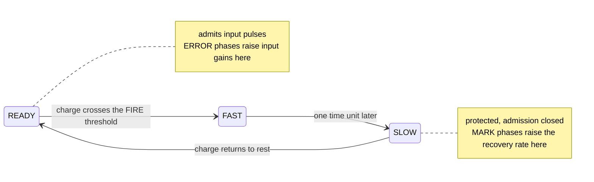

# kernel-R

[](https://github.com/HevisNico/kernel-R/actions/workflows/lean.yml)
[](https://github.com/HevisNico/kernel-R/actions/workflows/recursive-learning.yml)

**Current release** [v0.4.0](https://github.com/HevisNico/kernel-R/releases/tag/v0.4.0) · **Zenodo archive (all versions)** [10.5281/zenodo.23884521](https://doi.org/10.5281/zenodo.23884521)

Kernel R is a mathematical model of an asynchronous analog learning cell.
Its Lean 4 proofs start from the cell's differential equations and establish
what networks of these cells learn. The work is at the model stage: there
is no chip.

## In plain words

Analog chips can learn with very little energy, but two chips built from
the same design never behave quite alike. Train them the same way and
they end up with different memories.

Kernel R is a design for a small learning unit, called a cell, that
removes two causes of this.

- **How much a pulse teaches.** A cell learns by letting a small charge
  drain between two fixed levels. The amount learned depends only on
  those two levels. A slower cell takes longer and learns the same
  amount.
- **When to stop.** A cell trained with identical pulses stops learning
  by itself the moment it starts to fire. No memory value is tuned by
  hand.

Everything below is a theorem checked by a computer, or a numerical
result marked as such.

## The results in one table

| What a cell or a network does | Holds for | Theorem |
|---|---|---|
| One pulse adds a fixed dose to the memory, whatever the discharge rate | ±10% fabrication, ±5% on the thresholds | [`training_read_every_complete`](research/recursive-learning/native/ParameterTraining.lean) |
| Training with identical pulses stops by itself | any start gain below firing, firing level from 0.95 to 1.05 | [`stop_training_exists`](research/recursive-learning/native/TrainingLoop.lean) |
| A given chip has one behaviour | any finite network | [uniqueness](proof/lean/KernelR/HybridParameterUniversalExecution.lean) |
| Cells joined by wires behave as each cell alone predicts | any number of cells | [`acyclic_network_states`](research/recursive-learning/native/AcyclicNetwork.lean) |
| A chain learns the same amounts in every cell | any length | [`every_finite_chain`](proof/lean/KernelR/TrustedHeadline.lean) |
| Two cells decide whether two signals arrive together | a standard write provably fails | [`coincidence_exit_001_separation`](research/recursive-learning/native/CoincidenceSeparation.lean) |
| A network finds a hidden number among `2^k` | `2k + 1` cells, every `k` | [`successive_search`](research/recursive-learning/native/SuccessiveSearch.lean) |

| Word | Meaning here |
|---|---|
| Pulse | A short input signal lasting one time unit |
| Port | One of a cell's three inputs |
| Gain | How strongly a port's pulses charge the cell. This is the memory |
| Threshold | A charge level that triggers a change of phase |
| FIRE | The pulse a cell emits when its charge reaches its firing level |
| ERROR phase | The part of a sensor's discharge that raises a gain |
| Dose | The fixed amount that one ERROR phase adds to a gain |
| Need | The number of doses a port must receive before a pulse makes its cell fire |
| Complete run | An execution with no pending event left at its end time |

## The R cell

While ready, an R cell charges in response to input pulses. When its
charge crosses the firing threshold, it emits a pulse and enters a
protected recovery phase.



Each input port has a sensor that sees every pulse and cycles through
READY, MARK, SILENT and ERROR. A complete ERROR phase raises the
log-gain of its port by

```text
Δz = 8 × (entry − exit)
```

where `entry` and `exit` are the two thresholds of the phase. The
discharge rate sets how long the phase lasts and cancels from the
update. The sensor itself ends the update at the exit threshold, so
there is no clock and no controller.

See the [cell laws](model/CELL.md) and the [glossary](docs/GLOSSARY.md).

## What is proved

### 1. One pulse teaches a fixed dose

*How much a cell learns does not depend on how fast it discharges.*

A single cell trained by one pulse fires on a later read of the same
port, in every complete run. The theorem allows ±10% fabrication
variation and ±5% on both ERROR thresholds and on the FIRE level.

- A shift common to both ERROR thresholds, up to 4% of the entry level,
  leaves the dose unchanged.
- A fixed reaction delay `d` after each threshold crossing moves the
  dose by at most `2.4 × d`.

[`training_read_every_complete`](research/recursive-learning/native/ParameterTraining.lean) ·
[`training_read_common_offset` and `training_read_reaction_delay`](research/recursive-learning/native/OffsetAndDelay.lean)

### 2. Training stops by itself

*Send the same pulse again and again. The cell stops learning when it
starts to fire.*

A pulse that leaves the cell silent writes one dose. A pulse that makes
it fire writes nothing, because the write phase then falls inside the
refractory period. Training therefore ends at a gain set by the cell's
own firing level. No gain and no firing level is set by hand.

After training two ports, one pulse on each reads the cell, in either
order, at most a quarter of a unit apart. The cell fires later than
0.239 units after the first read pulse and no later than 0.256 units
after the second, whatever the start gains and the firing level.

[`stop_training_exists`](research/recursive-learning/native/TrainingLoop.lean) ·
[`OpenCell.read`](research/recursive-learning/native/FreeRead.lean)

### 3. One chip, one behaviour

*Simultaneous events can be processed in any legal order. The outcome
is the same.*

Thresholds are fields of each cell's parameters. For any finite network
with fixed parameters and wires, two runs from the same start that are
both complete through the same date have the same end state and the
same firing dates in each cell.

[semantics](proof/lean/KernelR/HybridParameterExecution.lean) ·
[uniqueness](proof/lean/KernelR/HybridParameterUniversalExecution.lean)

### 4. Cells compose

*Describe each cell alone. The network does what the descriptions say.*

- **Any network with forward wires.** One theorem turns the description
  of each cell into a complete run of the whole network, with the same
  firing dates and the same final memories in every complete run.
- **Trained cells.** Any number of cells trained as in result 2, each
  read by sources or by the FIRE of earlier cells. A chain of `n` such
  cells is proved for every `n`.
- **Chains under a fixed protocol.** In a chain of any length, every
  cell raises its active log-gain by 2.4 and its recovery rate by 0.3,
  across ±10% fabrication variation and bounded wire jitter.

[`acyclic_network_states`](research/recursive-learning/native/AcyclicNetwork.lean) ·
[`trained_wired_network` and `trained_chain_witness`](research/recursive-learning/native/WiredNetwork.lean) ·
[`TrustedHeadline.every_finite_chain`](proof/lean/KernelR/TrustedHeadline.lean) ·
[chain guide](docs/UNIVERSAL_FINITE_CHAIN.md)

### 5. Two cells decide a coincidence, and a standard write cannot

*Two cells detect that two signals arrive together.*

- **With trained cells.** Two cells with their own parameters, start
  gains and firing levels are trained as in result 2. Their two read
  FIRE dates are closer than 0.15 units exactly when the two cells are
  read at the same date, among offsets of −0.3, 0 and +0.3 units. The
  decision still holds when each cell acts with its own lag, for lags
  within 3/100 of a unit of each other.
- **Against a fixed-current write.** On a registered timing task, Kernel
  R gives the expected decision in every complete run. A write that
  applies a fixed current for a fixed time fails one admissible trial
  for every current and duration, under the same ±10% variation. This
  comparison uses cells with a start gain of exactly 1.2 and a firing
  level within ±3%; it is not redone with trained cells.

[`trained_coincidence_network`](research/recursive-learning/native/TrainedCoincidence.lean) ·
[`trained_network_lag`](research/recursive-learning/native/ReadLag.lean) ·
[`coincidence_exit_001_separation`](research/recursive-learning/native/CoincidenceSeparation.lean)

### 6. A network finds a hidden number

*`2k + 1` cells find one number among `2^k` and give it in binary.*

The hidden number `m` is the need of a port: how many doses it must
receive before a pulse makes its cell fire. It follows from the cell's
own start gain, dose and firing level.

- **A question.** A probe cell that receives `c` training pulses and
  then a read pulse fires on the read exactly when `m ≤ c`.
- **Acting on silence.** A trained cell read by one pulse fires late.
  Read by two it fires early. A gate cell therefore fires late exactly
  when a probe stayed silent.
- **The search.** One probe and one gate for each of `k` depths, and a
  learner. Each gate that answers no adds its binary weight to the later
  questions. The gates give the binary digits of `m − 1`, and the
  learner receives exactly `m` doses. The run lasts about `33 · 2^k`
  time units.
- **Tolerance.** Probes with different start gains, doses and firing
  levels share the same need inside a stated band. The dose error counts
  `m` times: a dose of 1/20 known to 1% separates needs up to 49.

A tree of `2^k − 1` questions, of which a run asks `k`, is also proved.

[`successive_search` and `successive_search_witness`](research/recursive-learning/native/SuccessiveSearch.lean) ·
[`bisection_search`](research/recursive-learning/native/BisectionSearch.lean) ·
[`needIs_of_tolerance`](research/recursive-learning/native/NeedTolerance.lean) ·
[map of the results](research/recursive-learning/native/README.md#map-of-the-stop-learning-results)

## What the benchmark showed

*A numerical result, registered before the sweeps.*

Each score counts passing combinations of ERROR and FIRE threshold
error, out of 36, on the coincidence task of result 5 with ±10%
fabrication variation, on 625 sampled points.

| Write rule | Needs a clock | Score |
|---|---|---:|
| Constant current, best tested setting | yes | 12 |
| Timed discharge, same duration as R (0.15) | yes | 8 |
| **Kernel R**, exit 0.025 | no | 16 |
| **Kernel R**, exit 0.01 | no | 22 |
| **Kernel R**, exit 0.0025 | no | 23 |
| Timed discharge, 0.4 or longer | yes | 27 |

Every Kernel R setting scores above the best tested constant-current
write. A timer long enough for the slowest device scores higher, at the
cost of a clock.

[protocol](research/recursive-learning/COINCIDENCE_BENCHMARK.md) ·
[numerical results](research/recursive-learning/coincidence/RESULTS.md) ·
[exit-threshold sweep](research/recursive-learning/coincidence/EXIT_TRADEOFF_RESULTS.md)

## Conditions

Results 2, 4 (trained cells), 5 (trained cells) and 6 share one regime:

| Quantity | Condition |
|---|---|
| Firing level | between 0.95 and 1.05, one value per cell |
| ERROR entry threshold | between 0.07 and 0.08 |
| ERROR exit threshold | at least 0.005, below the entry |
| Dose | at most 1/20 for the read windows |
| Recovery rate at the start | between 0.07 and 0.10 |
| Pulses on one cell | at least 22 units apart |
| Other parameters | anywhere within ±10% of nominal |

Result 1 uses an ERROR entry near 0.1. The chains of result 4 and the
fixed-current comparison of result 5 use nominal thresholds or the
bounds stated in their guides.

## Limits

- **A mathematical model.** Hardware measurements would be needed for
  experimental validation.
- **Exact quantities.** The pulse amplitude, the unit response and the
  MARK and SILENT levels are those of the model. See the
  [implementation assumptions](model/IMPLEMENTATION_ASSUMPTIONS.md).
- **Clocked wires.** In result 6 a FIRE inside a window releases pulses
  at preset dates. Such a wire stands for a clocked register, which is
  not built from cells.
- **Dose precision.** Separating `2^k` needs asks for a dose error below
  about `d₀ / 2^(k+1)`, for a nominal dose `d₀`.
- **Elementary tasks.** The networks hold at every size, on a
  coincidence decision and the search for one number.
- **Receiver.** The coincidence receiver is a decision rule on the two
  cells' firing dates.
- **Complete runs.** Theorems compare runs complete through a date. The
  declared tasks have complete witnesses.

More in the guides: [stop-learning results](research/recursive-learning/native/README.md#map-of-the-stop-learning-results),
[adaptive teaching loop](research/recursive-learning/native/README.md),
[exact dose counting](docs/EXACT_DOSE_COUNTING.md),
[chain progress](proof/lean/PROGRESS.md) and
[port-memory saturation](docs/GAIN_MEMORY_SATURATION.md).

## Related work

Analog synaptic increments that contain no discharge rate already exist.
The closest precedent we examined is the switched-capacitor synapse of
Noack et al., whose step is set by a capacitor ratio and control voltages
in a clocked circuit. Kernel R integrates a self-timed discharge between
two state thresholds and machine-checks how the updates compose.
[Noack et al.](https://www.frontiersin.org/journals/neuroscience/articles/10.3389/fnins.2015.00010/full) ·
[full comparison](docs/RELATED_WORK.md)

## How to check it

The project pins **Lean 4.35.0** and **Mathlib v4.35.0**.
Run each block from the repository root.

```sh
cd proof/lean
lake exe cache get
lake build
lake build Audit
```

```sh
cd research/recursive-learning/native
lake exe cache get
lake build
```

The core audit and the native package's default audit allow only
`propext`, `Classical.choice` and `Quot.sound` and fail on admitted proofs.
See the [validation ledger](docs/VALIDATION_LEDGER.md).

The [reviewer's reading path](REVIEW.md) starts with how the Lean
definitions represent the written model.

## Repository map

| Folder | Contents |
|---|---|
| [`model/`](model/README.md) | Cell laws and the chain protocol |
| [`proof/lean/`](proof/lean/README.md) | Core Lean development and audit |
| [`research/`](research/README.md) | Tolerant training, coincidence proofs and benchmark |
| [`docs/`](docs/UNIVERSAL_FINITE_CHAIN.md) | Theorem guides, trusted base, provenance |
| [`archive/`](archive/README.md) | Earlier experiments and specifications |

## Origin, AI assistance and license

This work draws inspiration from Nicolas Breuillaud's
[*The Reset Operator: A Structural Constraint on Recursivity*](https://ssrn.com/abstract=6964960).

Nicolas Breuillaud directs the work with assistance from **Claude**
(Anthropic) and **ChatGPT** (OpenAI) on models, code, proofs and
documentation. Lean checks the proof terms against their definitions and
hypotheses. Physical assumptions and claims outside those proofs remain
subject to independent review.

Source code is [MIT](LICENSE). Documents, proofs, data and other non-code
material are CC BY 4.0 under [LICENSE-docs.md](LICENSE-docs.md).
