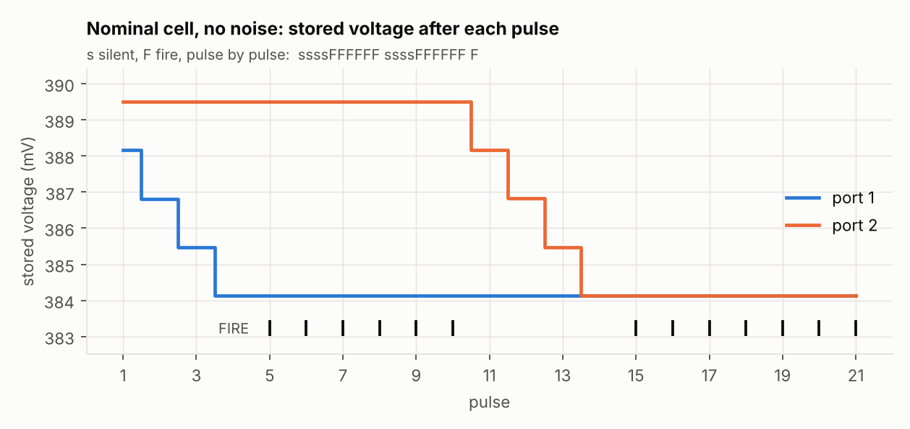
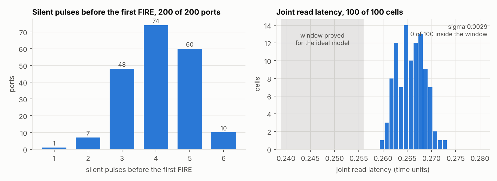
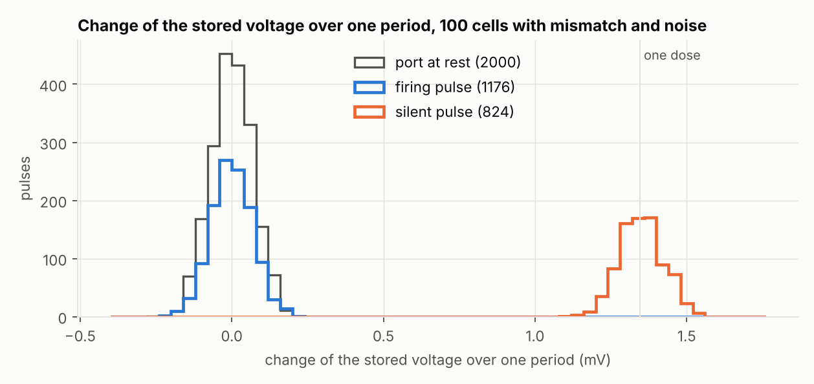
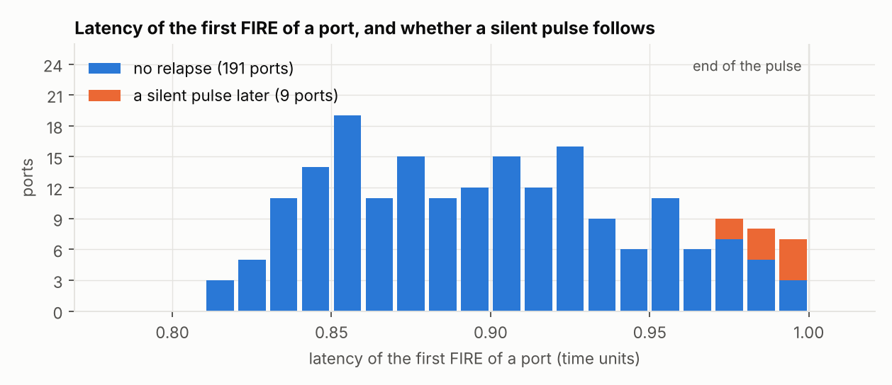
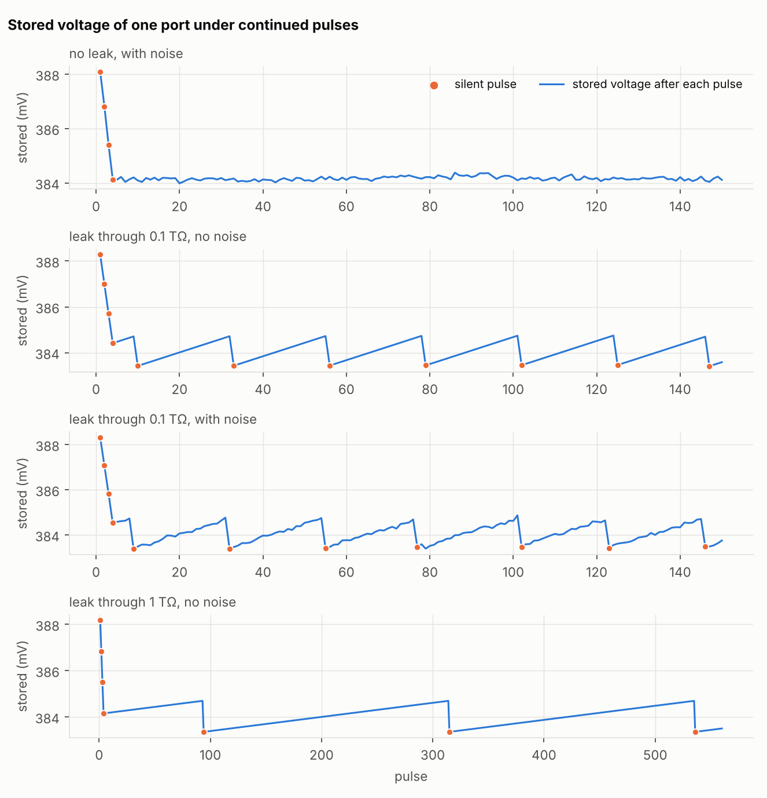
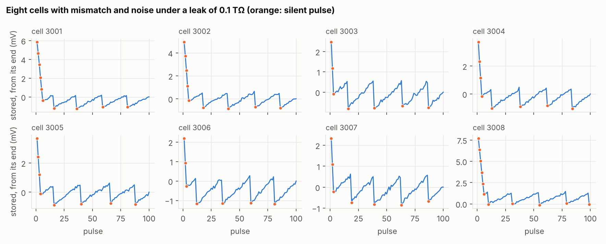

# Circuit simulation of one R cell

A transistor-level simulation of one R cell with two ports, in the
SkyWater 130 nm process, with ngspice and the open SKY130 device models.

**These are simulations. No chip was built and no layout was drawn.
Nothing here is a proof, and nothing here is a hardware measurement.**
The Lean proofs of the model are in [`proof/lean/`](../../proof/lean/README.md).

## Question

Does a cell that receives a train of identical pulses raise its gain
and stop by itself, with device mismatch and noise? Does it hold its
gain when the stored voltage leaks?

## What this does not test

- **The proved read window.** Two trained ports of this circuit fire
  together near 0.267 time units. The window proved for the ideal model
  is (0.239, 0.256]: theorem `stopped_pair_read_latency` in
  [`StopLearningLatency.lean`](../recursive-learning/native/Training/StopLearningLatency.lean).
  The circuit is outside that window, and no result here is a test of
  it.
- **A cell without a clock.** The circuit does not detect the arrival
  of a pulse. With each pulse the stimulus gives three ideal timing
  signals: the admission during the pulse, the reset of the sequencing
  latches 1 µs before the pulse, and the end of the precharge of the
  sensor. The end of the write is set by the sensor itself. See
  [what the stimulus provides](DESIGN.md#what-the-stimulus-provides).

The campaign tests the mechanism: a write on a silent pulse, no write
on a firing pulse, a stop that holds, and a read that agrees between
cells.

A separate [conditional Lean bridge](lean/README.md) connects capacitor
charge balances to the kernel's ERROR-dose identity, bounds current and
calibration errors, derives a common scalar need for varying write doses,
and transfers strict scalar-contact margins with a latency bound. Separate
ideal read windows allow doses up to 0.06. It does not certify the netlist
or transfer those numerical read windows to this circuit. The bridge README
distinguishes the substantive results from algebraic interface identities;
audit declaration counts measure coverage, not scientific contributions.

The [fixed need-tolerance test rule](NEED_TEST_PROTOCOL.md) records the
qualification criteria, required measurements and failure reporting before
any new campaign. The existing 200-port analysis is retrospective; the rule
does not turn it into a preregistered experiment.

## Results

The campaign has 141 runs. All produced a result, and the guard
reported nothing. Of 5 checks and 19 predictions, **22 hold and 2
fail**. The table of verdicts is in [`VERDICTS.md`](VERDICTS.md).

| Question | Result |
|---|---|
| Does the nominal cell stop? | Each port is silent for 4 pulses, then fires on the 6 that follow. Each silent pulse writes 1.346 to 1.347 mV. A firing pulse moves the stored voltage by 0.001 mV at most |
| Does noise move the stop? | No: 4 silent pulses on both ports in 20 runs of 20 |
| Do cells with mismatch and noise stop? | All 200 ports of 100 cells stop, after 1 to 6 silent pulses |
| Does a firing pulse write? | The steering switch to the integrator is never turned on, on any of the 3 526 firing pulses of the campaign. The charge that the integrator receives was measured afterwards on five runs: at most 0.03 fC on a firing pulse without noise, 0.07% of a dose, and at most 0.23 fC with mismatch and noise, 0.56% of a dose |
| Is the write itself noisy? | Not resolved. A silent step (sigma 0.070 mV) is not noisier than the change of a port at rest (0.071 mV), so the noise of the write is hidden by the noise of the read. Its 95% interval ends at 0.037 mV, 2.7% of a dose |
| Do the cells read alike? | All 100 cells fire on the joint pulse, between 0.2595 and 0.2730, sigma 0.0029. Every pair of cells is within 0.05 |
| Does a port fall silent again after its stop? | 9 ports of 200 have one silent pulse after their first FIRE. All 9 first fired later than 0.97, at the very end of the pulse. None does it twice |
| Corners and temperature | The cell stops at ss, ff, sf, fs, at −40 °C and at 125 °C, after 4, 4, 4, 4, 2 and 7 silent pulses. Joint read from 0.2635 to 0.2705 |
| Without a leak, does the gain hold? | Yes: no silent pulse after the stop in a run of 150 pulses, with and without noise |
| Under a leak, does the cell maintain itself? | Yes. Under 0.1 TΩ it falls silent for one pulse every 22 or 23 periods, writes one dose and fires again. The stored voltage stays within one dose. With noise: every 21 to 25 periods, within 1.11 dose |
| With mismatch, noise and a leak? | The 8 cells maintain themselves: a silent pulse every 21.7 to 24.0 periods on average, never two in a row, within 1.03 to 1.18 dose |













### The two predictions that fail

**P2. Sigma of the joint read under noise.** Predicted below 0.0012.
Measured 0.00128 on 20 runs. Every read is inside the predicted range.

- Twenty runs do not fix this sigma well. Resampling the 20 runs gives
  a 95% interval from 0.00068 to 0.00166. The limit of 0.0012 is inside
  it.
- A second sample of the same 20 runs, made after the campaign, gives
  0.00062 and holds P2. See [`COMPLEMENT.md`](COMPLEMENT.md).
- The campaign does not settle P2. Its verdict as written stays: fails.

**P6. Number of silent pulses with mismatch.** Predicted 2 to 8 on
every port. One port of 200 stops after 1 silent pulse.

- The number of silent pulses of a port is its start gap in doses,
  rounded up. The start gap is the log of the ratio of the firing gain
  to the start gain. On 190 ports of 200 the count is exactly that.
  The 10 others are within 0.06 dose of a whole number.
- Over the 200 ports the start gap has a mean of 3.55 doses and a sigma
  of 0.90. A gap below 1 is rare and not excluded: a normal law with
  that mean and sigma puts 0.4 port of 200 there.
- The port in question has a start gap of 0.65 dose. The other port of
  its cell needs 4 silent pulses. That cell fires on the joint pulse at
  0.2695, inside the range of the other cells.
- The predicted range was too narrow. The mechanism allows any count.

### Found on the way

- **The dose in log-gain is 0.042, not 0.05.** At 27 °C one step of the
  stored voltage raises the gain by 4.3%. It is 0.052 at −40 °C and
  0.033 at 125 °C: the dose is fixed in volts and the slope of the gain
  law follows the temperature. See the observations at the end of
  [`VERDICTS.md`](VERDICTS.md).
- **Eleven FIREs are printed with a latency of exactly 1.** It is the
  rounding of the printed times, not a FIRE at the edge. See
  [the resolution of the measures](DESIGN.md#resolution-of-the-measures).
- **A noisy run is not reproduced by its seed.** See the next section.

## What can be reproduced

- **A run without noise is reproduced exactly.** The nominal run, run
  again, gives the same file byte for byte.
- **A noisy run is not.** Its seed sets its mismatch sample and not its
  noise. Run again with the same seed, it draws another noise sample.
  The seeds stay in the list of runs, but they do not replay the noise.
- **No sign that two runs share a noise sample.** In one diagnostic on
  the 120 noisy cell runs of the campaign, no pair of runs shows the
  correlation that a shared sample would give. This does not prove that
  the samples are independent.
- **Running the campaign again gives other runs from the same
  distribution.** What should come out again is the verdicts and the
  orders of magnitude, not each run.
- **A number that comes from noise has an interval.** The intervals are
  at the end of [`VERDICTS.md`](VERDICTS.md). The repeated runs are in
  [`COMPLEMENT.md`](COMPLEMENT.md).

**Status of the complement: two series are still being computed.** The
four repeats of each noisy refresh run, two more samples of the 20
noise runs and the replay of one corner without noise are not in this
folder yet. `COMPLEMENT.md` marks them as missing.

## Files

| File | Contents |
|---|---|
| [`DESIGN.md`](DESIGN.md) | The circuit, the reason for each design choice, the noise, the solver settings, what is not modelled |
| [`PREDICTION.md`](PREDICTION.md) | Checks and predictions, written before the campaign |
| [`VERDICTS.md`](VERDICTS.md) | The status of each check and prediction, the state of each run, the guard, and observations made after the campaign |
| [`COMPLEMENT.md`](COMPLEMENT.md) | Runs made after the campaign: replays with the same seeds |
| [`cell.spice`](cell.spice), [`blocks.spice`](blocks.spice) | The netlist of the cell and its building blocks |
| [`run.py`](run.py) | Runs one cell and writes one row per pulse |
| [`campaign.py`](campaign.py) | The list of runs of the campaign, and its launcher |
| [`analyze.py`](analyze.py) | Applies the guard, gives a status to each prediction, draws the figures |
| [`test_analyze.py`](test_analyze.py) | Tests of the analysis on synthetic campaigns |
| [`complement.py`](complement.py), [`gate_current.py`](gate_current.py), [`compare.py`](compare.py) | The runs of the complement and their comparison with the campaign |
| [`noise.py`](noise.py), [`noise.json`](noise.json) | Noise analysis of each block and the levels injected |
| `results/` | The campaign: one file per run, one row per pulse |
| `results_rel*/`, `results_rep*/`, `results_check/`, `results_gate/` | The complement: replays, repeats, runs without noise run again, and the charge received by the integrator |

## Method

- **Predictions written before the campaign, which this repository
  cannot show.** [`PREDICTION.md`](PREDICTION.md) was committed on
  2026-11-12 at 07:22 UTC in a private working repository, commit
  `a8fd219`. The first run started at 07:23 UTC. The file entered this
  repository at 09:02 UTC, after the campaign had started. Its SHA-256,
  `8c17bf311e7f1353a6a41da84ad8f9c4fd3b4b6ff150c2a6009b620e935181e8`,
  shows that the file is the same. It does not show the date. A reader
  of this repository alone has to take the date on trust.
- **The predictions are not blind.** The file says what was known when
  it was written.
- **One netlist, one set of options.** Every run of the campaign uses
  the same netlist, the same solver options and the same largest time
  step.
- **A guard on every run.** It reports a protection that cannot be a
  FIRE, and any event that counts against the mechanism. See
  [the guard](DESIGN.md#the-guard).
- **Three statuses.** A check holds, fails, or is not evaluable, each
  with its reason. The analysis always writes the whole report. It is
  tested on synthetic campaigns where the nominal cell never fires, the
  joint read never fires, no port fires in the refresh runs, no relapse
  comes under a leak, runs are missing, and the guard has something to
  report.
- **One list of runs.** The launcher and the analysis read the same
  list. A run without a result is reported as not evaluable.
- **A failed prediction stays** in the report with its verdict.

## Corrections to the prediction file

`PREDICTION.md` is left as written. Three things in it are corrected
here.

- It gives the proved window as (0.239, 0.2554]. The theorem gives
  (0.239, 0.256]. The value 0.2554 has no source in this repository.
  The circuit, near 0.267, is outside both.
- It puts every event of the guard in one class, left out of the
  statistics. The analysis now keeps in the statistics the events that
  count against the mechanism: a FIRE after the end of the pulse, a
  protection that rises twice, a protection without an end. They are
  reported and they make P19 fail. A FIRE after the end of the pulse
  belongs to the list of what would count against the mechanism.
- It says that every run uses a seed that was never run. For the noise
  this means nothing: the seed of a run does not set its noise sample.

## Made after the campaign

The 141 runs and the runner were not touched while the campaign ran.
What follows was done afterwards.

- **The analysis was rewritten.** The first version stopped without a
  report when a result was negative, removed from the statistics a
  FIRE after the end of the pulse, expected 146 runs where the plan has
  141, and wrote the conclusion in the titles of the figures. The
  verdicts in `VERDICTS.md` come from the rewritten analysis.
- **Observations were added** to the report: the dose in log-gain and
  the start gap of each port. They are not predictions.
- **A complement was run:** replays with the same seeds, repeats of
  the noisy runs, runs without noise once more, and five runs with an
  ammeter in front of each integrator. `run.py` got an option that prints each time
  from the start of its pulse. Without the option it gives the same
  result as the campaign, byte for byte, on the nominal run.

## The campaign

| Series | Runs | Conditions |
|---|---|---|
| Nominal cell | 2 | Typical corner, 27 °C, no noise. One run with 26 pulses per port |
| Noise | 20 | Typical corner, noise on |
| Mismatch and noise | 100 | Monte Carlo mismatch, noise on |
| Corners and temperature | 6 | ss, ff, sf, fs at 27 °C; typical at −40 and 125 °C; no noise |
| Refresh | 5 | One port, 150 to 560 pulses; no leak, 0.1 TΩ or 1 TΩ; with and without noise |
| Refresh with mismatch and noise | 8 | One port, 100 pulses, 0.1 TΩ |

One time unit is 20 µs. A cell run is 22 periods of 440 µs.

The campaign ran from 07:23 to 09:55 UTC on four cores. It was stopped
once by a time limit of the machine, at 09:23 after 101 runs, and
resumed at once. The four runs that were being computed, cells 2061 to
2064, had written nothing and were run again from the start.

## For a next campaign

- Print each time from the start of its pulse (`rel=1`).
- Make the noise reproducible. Seeding the simulator does not do it.
  Noise sequences generated from the seed outside the simulator, and
  fed to it as sources, would. Check it by running one run twice.
- Commit the predictions in this repository before the first run.
- Build the detection of the pulse, or state again that it is ideal.

## Running

ngspice 42 and Python 3 with numpy 2 and matplotlib are needed.

```sh
cd research/circuit
sh fetch_pdk.sh
cp spiceinit.txt .spiceinit
mkdir -p work results
python3 campaign.py
python3 analyze.py
python3 -B -m unittest test_analyze
```

`fetch_pdk.sh` fetches the SKY130 primitive models at a fixed commit.
They are not part of this repository. The campaign takes about two and
a half hours on four cores.
