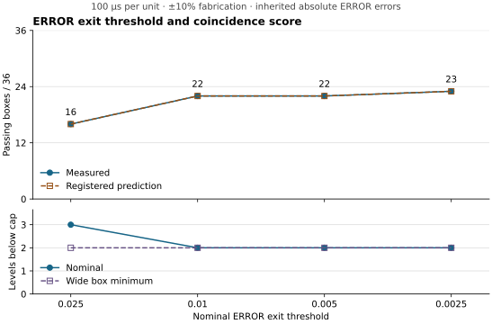

# ERROR exit tradeoff results

At 100 µs per unit the four scores matched the
[registered predictions](EXIT_TRADEOFF_PREDICTION.md). The 0.01 and
0.005 exits passed the same 22 cases. The 0.0025 exit added one case,
ERROR ±5% with FIRE nominal. All three lower exits have two nominal
levels below the cap, compared with three at the original exit.



| ERROR exit | Full log-gain dose | Nominal ERROR duration | Predicted score | Observed score | Nominal levels below cap | Wide box minimum |
| ---: | ---: | ---: | ---: | ---: | ---: | ---: |
| 0.025 | 0.60 | 0.150 | 16 | 16 | 3 | 2 |
| 0.01 | 0.72 | 0.249 | 22 | 22 | 2 | 2 |
| 0.005 | 0.76 | 0.324 | 22 | 22 | 2 | 2 |
| 0.0025 | 0.78 | 0.399 | 23 | 23 | 2 | 2 |

The level count includes the initial gain and each full dose that leaves
the gain below its cap. The cap is a separate state. The wide box minimum
uses cap 3.6 and the maximum perturbed dose. These are arithmetic
capacity counts for successive full writes. Each timing trial performs
one training write.

The passes were identical across all three fabrication radii at each
scale. All scores are out of 36 ERROR × FIRE boxes.

| Scale (µs/unit) | Exit 0.025 | Exit 0.01 | Exit 0.005 | Exit 0.0025 |
| ---: | ---: | ---: | ---: | ---: |
| 50 | 30 | 35 | 35 | 35 |
| 100 | 16 | 22 | 22 | 23 |
| 200 | 8 | 10 | 12 | 12 |

The sweep reused the same 625 points. The 0.025 and 0.0025 endpoints
reproduced the previous timing margins exactly. Across the new rows
the latest training ERROR exit was 1.721, the largest read sensor
residual was 0.00001612, and the smallest log-gain headroom was 0.27461.
The checks and scores describe the reduced numerical benchmark.

The protocol was committed at `edf4a17c030560b1b125c710e51d4dc438b0c769` before the runner
at `e89915e4e2679beb41c1be8ad28b6d032210e74d` and the first sweep. The
[CSV](results/exit-tradeoff.csv.xz) and [manifest](results/exit-tradeoff-manifest.json)
contain the detailed results and hashes. The figure is available as
an [SVG](results/exit-tradeoff.svg) with trailing whitespace removed.

```sh
python -m pip install -r research/recursive-learning/coincidence/plot-requirements.txt
python research/recursive-learning/coincidence/exit_tradeoff.py output/exit-tradeoff \
  --protocol-commit edf4a17c030560b1b125c710e51d4dc438b0c769 \
  --runner-commit e89915e4e2679beb41c1be8ad28b6d032210e74d
```
